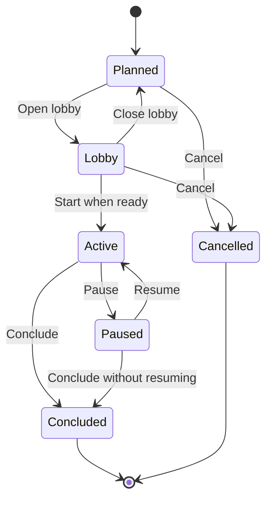

# Campaign Session Vertical Slice — Gate 1 Implementation Plan

Status: Gate 2 approved; implementation committed locally

Scope: Session planning, lobby, participation, lifecycle, journal boundaries, and a discrete operational shell

Depends on: Campaign Instance vertical slice through `bc6aacd`

> The route inventory in section 7 is **deprecated and excluded from future API analysis and
> generation**. It records the compatibility API delivered by this historical slice. Use
> `docs/api-information-architecture-realignment.md` for current and target routes.

## 1. Outcome

This slice makes a Session a usable, resumable period of play belonging to exactly one Campaign
Instance. A GM can plan a Session, select participants from the Instance roster, invite them, open a
lobby, satisfy readiness, start play, pause and resume it, conclude it with a sealed journal and
summary, or cancel before play begins. Players and Spectators receive role-appropriate lobby and
Session projections. This slice also captures and validates immutable Session-local capability
grants for authorized Agents; an authenticated transport through which autonomous Agent processes
consume projections or submit capability-gated commands is a later integration boundary.

The Session is a journal, attendance, and timing boundary. It does **not** copy or own the Campaign
Instance runtime. Party composition, current Location, campaign time, Creature and Item state,
reveals, Scenes, and Encounters remain in the versioned Campaign Instance runtime. Session records
identify the runtime revisions and Instance snapshot against which play occurred.

The visible actions for returning to resumable work are **Continue** and **Resume**. The operational
play workspace remains structurally separate from World Authoring, Campaign Definition Authoring,
and Campaign Instance Management.

## 2. Binding domain decisions

- A Session belongs to one Campaign Instance, never to a Campaign Definition.
- A Session references the Instance's current captured Campaign/World snapshot; it does not capture
  another Definition hierarchy.
- Session participation is separate from durable Campaign Instance membership.
- Session invitations select existing human Instance memberships. They do not create a second
  profile, infer identity from contact data, or silently add someone to the Instance.
- The GM is both operator and required Session participant. The GM participation row is created
  atomically with the Session.
- Selected Players are required participants. Selected Spectators are optional. A configured Agent
  may be included only through its Instance Agent participation and explicit Session capabilities.
- No more than eight participants, including the GM, may be selected for the MVP Session.
- Multiple Sessions may be planned or waiting in lobbies. At most one Session across the
  installation may be in the `active` state.
- At most one Session across the installation may be resumable (`active` or `paused`). This stricter
  open-journal invariant prevents ambiguous Resume behavior and overlapping runtime revision
  segments. Multiple historical or planned Sessions remain valid.
- A paused Session is not actively accepting play commands. Instance migration is therefore
  allowed while it is paused, as previously decided. Resuming after migration records an explicit
  snapshot/runtime-boundary event before accepting another command.
- A cancelled Session never opens a runtime event segment and cannot be resumed.
- A concluded Session is immutable except for the separately versioned summary workflow and
  explicitly audited administrative annotations.
- Player/account standing, Instance membership, Session invitation response, lobby presence, and
  durable Session attendance are distinct state.
- Internal identifiers may appear in routes and command values but never as visible labels or
  error-message fallbacks.

## 3. Current implementation and gaps

The Campaign Instance slice already provides:

- relational `CampaignInstanceSession` and `SessionParticipation` scaffolding;
- a database-enforced installation-wide unique `ACTIVE` Session;
- owner-scoped Session list and deterministic Continue/Resume projections;
- migration locking that prevents an active Session and Instance migration from crossing;
- durable Instance memberships, invitations, Agent participation, Characters, snapshots, runtime
  CAS, checkpoints, and audit events;
- an Instance Sessions page that currently provides read-only grouped lists; and
- a client-only Session canvas laboratory that is not connected to canonical Instance runtime.

The slice must not mistake those structures for a finished Session subsystem. Missing behavior
includes:

- no Session create, schedule, edit, lobby, start, pause, resume, conclude, or cancel commands;
- no Session detail or readiness projection;
- no Instance-invitation acceptance path that creates the durable provider-neutral profile and
  Instance membership needed by remote Session participation;
- no Session-specific invitation, response, presence, or attendance commands;
- no append-only Session event segment or runtime-boundary checkpointing;
- no summary lifecycle;
- no participant-safe Session projection or authorization policy;
- no production operational Session shell; and
- legacy `SessionState`, `GameState`, generic `sessions`, `games`, `scenes`, `encounters`,
  `pending-decisions`, and `game-events` contracts that remain compatibility inputs rather than the
  new write authority.

## 4. Scope

### 4.1 Included

1. Canonical Session, participation, invitation-response, presence, event-segment, summary, and
   runtime-boundary contracts in `packages/common/src/types`.
2. Provider-neutral Campaign Instance invitation resolution and acceptance sufficient to create a
   durable authenticated profile and Instance membership. Auth0 remains an adapter added later.
3. Idempotent Session creation with automatic GM participation.
4. Planning, schedule/name/notes editing, roster selection, invitation delivery, response, and
   cancellation.
5. Lobby presence and readiness for GM, Players, Spectators, and authorized Agents.
6. Server-enforced start, pause, resume, conclude, and cancellation transitions.
7. A single installation-wide open/resumable Session and a single active Session.
8. Append-only ordered Session events and immutable start/pause/resume/conclusion runtime
   boundaries.
9. Draft and GM-approved Session summaries based on a sealed event segment.
10. GM Session management, GM lobby, participant lobby, and a minimal discrete operational shell.
11. Continue/Resume integration on Home and Campaign Instance pages.
12. Quick Start integration for planning and beginning the first Session.
13. Compatibility quarantine, database migration, security review, accessibility review, and
    database-backed concurrency/rollback tests.

### 4.2 Explicitly deferred

- Auth0 integration, SSO, account linking, and authentication-provider administration.
- Character authoring/import. This slice consumes Character readiness and blocks required Players
  whose Character is not ready.
- Video, audio, WebRTC signaling, recording, and spectator media composition.
- Map editing, fog, token movement, Scene authoring, Encounter execution, combat, Rules execution,
  rolls, pending decisions, and player action submission.
- Chat and the private Spectator channel.
- AI-generated narrative summaries. The summary model and approval boundary are included; automated
  drafting and authenticated autonomous Agent transport are later.
- Backup retention and full disaster-recovery UI. Conclusion emits a durable backup-request
  integration event, but backup execution is a later infrastructure slice.
- Multiple simultaneous active Sessions, breakout tables, co-GM operation, and guest identities.
- Replacing all legacy game/session data. Read-only compatibility and export remain until a later
  cutover.
- Exact union accounting for overlapping multi-device presence leases. Gate 1 bounds every lease
  and preserves join/leave history, but simultaneous leases for one participant can overstate the
  accumulated duration until normalized presence intervals are introduced.
- Persistence hardening that binds runtime-boundary and summary sequence pointers directly to
  Session event rows, and freezes completed invitation-delivery attempts after their terminal
  outcome. Gate 1 enforces scoped sequence uniqueness, service-level creation, and append-only
  Session events/boundaries.

The minimal operational shell proves secure Session entry, current human-readable context,
participant state, lifecycle controls, and the live event segment. It does not claim the deferred
full play experience.

### 4.3 Fast-follow: contextual API hierarchy realignment

This fast-follow is now governed by `docs/api-information-architecture-realignment.md`, which
expands it into a product-wide API ownership audit and makes the Session hierarchy the first
implementation wave. The Gate 1 implementation and its historical routes remain unchanged in this
record.

The follow-up must:

- make the Campaign Definition → Campaign Instance relationship explicit in GM-facing routes,
  beginning with a shape such as
  `/api/campaigns/:campaignDefinitionId/instances/:campaignInstanceId/...`;
- remove redundant parent identifiers from mutation payloads and derive them from the route and
  authenticated context;
- enforce every nested route with parent-and-child scoped queries and composite persistence
  relationships rather than treating URL nesting alone as an integrity boundary;
- preserve Campaign Definition lineage identity while an Instance adopts later compatible
  Definition and World snapshots;
- examine the remaining API for comparable ownership relationships—including World Definition
  revisions and snapshots, Campaign Definition revisions/drafts/snapshots/Plots, Instance
  Sessions/participants/invitations/runtime resources, Characters and memberships, taxonomies and
  their entries, media ownership, and hosted-system integration resources—and recommend consistent
  nesting where it materially clarifies authority or prevents mismatched associations;
- identify routes that should deliberately remain un-nested, such as public invitation resolution
  or participant entry points where authoring provenance is not part of the user's task; and
- provide a compatibility, deprecation, client-migration, authorization-test, and rollout plan
  before changing existing routes.

The audit and detailed route proposal are intentionally deferred to that activity; they are not to
be performed opportunistically during this Session slice.

## 5. Canonical domain model

### 5.1 Session aggregate

`CampaignSession` is the lifecycle aggregate. The existing `CampaignInstanceSession` name may be
retained in persistence, but the common contract must make ownership and semantics explicit.

Required fields and relationships:

- identity and human-readable name;
- owning Campaign Instance;
- lifecycle status: `planned`, `lobby`, `active`, `paused`, `concluded`, or `cancelled`;
- monotonic metadata revision for compare-and-swap commands;
- optional scheduled date/time and planning notes;
- created-by GM and timestamps;
- lobby-opened, started, paused, resumed, concluded, or cancelled timestamps as applicable;
- start snapshot ID and start runtime revision;
- current/last runtime revision;
- end snapshot ID and end runtime revision after conclusion;
- ordered event-segment bounds;
- summary status and current summary revision; and
- namespaced extensions.

The Session does not contain a copy of Instance runtime JSON. Snapshot and runtime-revision fields
are consistency anchors, not ownership transfers.

### 5.2 Lifecycle



Every transition is a named server command. Generic status replacement is forbidden.

- `planned → lobby` freezes the selected required-player set for the current invitation round and
  issues/reuses Session invitations.
- `lobby → planned` closes presence leases but preserves responses and delivery history.
- `lobby → active` atomically checks readiness, claims the installation-wide active/open Session
  constraint, records the Instance snapshot and runtime revision, appends the start event, and
  activates the Instance if it was ready but not yet active.
- `active → paused` closes command admission, appends a pause event, and records a runtime boundary.
- `paused → active` rechecks Instance consistency and readiness. If the Instance migrated while
  paused, it records the newly adopted snapshot before appending the resume event.
- `active|paused → concluded` seals the event segment, records the end boundary, converts current
  presence to durable attendance intervals, and opens a summary draft.
- `planned|lobby → cancelled` records a reason, invalidates Session invitation tokens and presence
  leases, and never changes Instance runtime.

### 5.3 Participation

`SessionParticipation` references exactly one of:

- a human `CampaignInstanceHumanMembership`; or
- a `CampaignInstanceAgentParticipation`.

It owns Session-local facts:

- participant display-name snapshot for durable history;
- role-at-session: GM, Player, Spectator, or Agent;
- required/optional classification;
- invitation response: not requested, pending, accepted, or declined;
- optional participant response message and response timestamp;
- durable attendance: pending, attended, excused, or did not attend;
- first joined, last left, and total present duration;
- whether the participant acted; and
- Session capabilities resolved from role and Agent grants.

Changing Instance membership does not rewrite historical participation. Before a Session starts,
revoked/banned/inactive membership blocks that participation and readiness. The GM can remove a
selected participant while the Session is planned or in the lobby; removing a required Player is a
roster edit, not a readiness override, and is audited.

### 5.4 Session invitation

A Session invitation belongs to one human Session participation. It references the participant's
existing Instance membership and protected contact methods; it never copies decrypted contact data
into Session tables.

It owns:

- a one-way token hash, expiration, issue/revoke/accept timestamps, and issuer;
- an invitation revision/reissue lineage;
- contact-channel selection by protected contact reference;
- contact-free delivery attempts starting in `pending`; and
- rate-limit and audit metadata.

The join URL carries its secret in the fragment. Secrets, contact values, provider payloads, and
opaque identifiers are excluded from logs and GM-visible labels. Reissue revokes the prior token.
Resolving a Session invitation never creates or guesses a membership.

### 5.5 Response, presence, and attendance

These must not collapse into one status:

- **Response** is the durable answer to the invitation.
- **Presence** is a short-lived lobby/play connection lease.
- **Attendance** is the durable historical outcome finalized at conclusion.

`SessionPresenceLease` is bounded and renewable. It records participant, Session, connection key
hash, role, phase, joined time, last heartbeat, expiry, and optional ejection. A lost client becomes
absent after lease expiry without being marked as having never attended. Durable join/leave/eject
events and accumulated presence intervals support history and reconnection. Heartbeat renewals
update the lease without appending journal events, avoiding an administrative event flood.

Presence initially uses authenticated polling or Server-Sent Events plus heartbeat commands. This
keeps transport replaceable by the later real-time media subsystem. Presence is not inferred from a
browser tab merely loading.

### 5.6 Readiness

The authoritative readiness projection contains human-readable checks and blocking detail:

- Session is in `lobby` and its metadata revision is current;
- Campaign Instance is active or ready to activate and is not concluded/archived;
- no different Session is active or paused anywhere in the installation;
- Instance runtime and current snapshot are valid and not being migrated;
- no client-declared preparation save is outstanding, and the submitted expected runtime revision
  still matches;
- GM presence is current;
- every selected Player has an active Instance membership;
- every selected Player has accepted, is present, and has a ready active Character association;
- selected Spectators are valid but never block start through absence;
- selected Agents are authorized and capability-valid but block only when explicitly marked
  required; and
- participant count is within the installation limit.

The server returns a short-lived readiness token/hash covering Session revision, Instance runtime
revision, current Instance snapshot, required roster, responses, presence generations, and
Character-readiness inputs. Start recomputes readiness inside the transaction; it never trusts the
displayed projection alone.

### 5.7 Event segment

Replace `eventLog` JSON as the new write authority with append-only `CampaignSessionEvent` rows:

- Session ID and monotonically increasing Session sequence;
- occurred-at time and optional campaign time;
- event type and human-readable summary;
- actor attribution to GM, human participation, Agent participation, or runtime entity;
- optional runtime revision before/after;
- optional caused-by event;
- visibility: GM, participants, Players, Spectators, or public-to-Session;
- bounded typed payload and namespaced extension data; and
- integrity hash linking the prior event where practical.

Lifecycle, invitation response, roster, durable presence transitions (join, leave, and eject),
summary, and future game commands append through one service. Heartbeat lease renewals do not
append. Planning and lobby administration may therefore precede play in the same ordered Session
history: `firstEventSequence` identifies the start event that opens the play segment, while
`lastEventSequence` tracks the latest event across the complete Session history. Clients cannot
post arbitrary event records. Rules execution later supplies typed game events through the same
append boundary.

### 5.8 Runtime boundaries and consistency

Session start, pause, resume-after-migration, and conclusion create immutable runtime boundary
records referencing:

- Campaign Instance snapshot;
- Instance runtime revision;
- reason and Session sequence;
- content hash; and
- actor/time.

These may reuse the existing immutable Campaign Instance runtime-checkpoint infrastructure with new
Session boundary reasons, provided the composite foreign keys preserve Instance ownership.

### 5.9 Summary

`CampaignSessionSummary` has its own revision and lifecycle:

- `draft` after conclusion;
- `approved` by a GM against an exact sealed event sequence; and
- `amended` by producing a new revision, never overwriting an approved revision.

The summary contains constrained rich text, optional private GM notes kept in a separate field, and
human-readable participant/runtime context. Approval creates an audit event and durable
`session-backup-requested` integration event. Automated narrative generation and backup execution
remain deferred.

## 6. Persistence changes

Use an additive Prisma migration. Do not repurpose legacy generic domain records.

1. Extend `CampaignInstanceSession` with `metadataRevision`, `LOBBY`, lifecycle timestamps, runtime
   boundary references, event segment bounds, summary status, cancellation reason, idempotency key,
   and audit metadata.
2. Strengthen lifecycle check constraints so timestamps and status cannot contradict each other.
3. Add a partial unique installation-wide index for `ACTIVE` or `PAUSED`, while retaining a separate
   active-only invariant if operational queries require it.
4. Extend `SessionParticipation` with role-at-session, required flag, response message/time,
   attendance totals, and capability snapshot. Preserve exact-one human/Agent foreign keys.
5. Add Session invitation, delivery-attempt, presence-lease/interval, event, runtime-boundary,
   summary-revision, and integration-outbox tables.
6. Add same-Instance composite foreign keys from every Session-owned record.
7. Make Session events and runtime boundaries append-only with database triggers.
8. Add unique `(sessionId, sequence)` and indexes for current lobby, token lookup, presence expiry,
   response/readiness queries, and paged event reads.
9. Reconcile existing rows deterministically:
   - `ACTIVE → active`, `PAUSED → paused`, `PLANNED → planned`, `CONCLUDED → concluded`, and
     `CANCELLED → cancelled`;
   - preserve human names and timestamps;
   - retain legacy `eventLog` and `summary` as read-only import evidence;
   - materialize normalized events/summaries only when conversion is lossless; otherwise attach an
     explicit legacy-history marker; and
   - reject deployment if existing data violates the single resumable-Session invariant unless a
     deterministic, documented reconciliation can preserve every row.

Database deployment must assess row counts and run during low traffic because enum/table changes,
constraint validation, and index creation may block writes.

## 7. API direction

**Section status: deprecated compatibility history; excluded from future API analysis and
generation.** The canonical replacements are recorded in
`docs/api-information-architecture-realignment.md`.

All mutation endpoints require idempotency keys where retries could duplicate records and CAS
revisions where stale browser state could overwrite a newer decision.

### 7.1 GM management

- `POST /campaign-instances/:instanceId/sessions`
- `GET /campaign-instances/:instanceId/sessions`
- `GET /campaign-instances/:instanceId/sessions/:sessionId`
- `PATCH /campaign-instances/:instanceId/sessions/:sessionId`
- `PUT /campaign-instances/:instanceId/sessions/:sessionId/participants`
- `POST /campaign-instances/:instanceId/sessions/:sessionId/invitations`
- `POST /campaign-instances/:instanceId/sessions/:sessionId/invitations/:invitationId/retry`
- `DELETE /campaign-instances/:instanceId/sessions/:sessionId/invitations/:invitationId`
- `GET /campaign-instances/:instanceId/sessions/:sessionId/readiness`
- named lifecycle commands: `open-lobby`, `close-lobby`, `start`, `pause`, `resume`, `conclude`, and
  `cancel`
- paged event and summary endpoints

The controller uses the Campaign Instance owner/GM capability boundary. Every query scopes by both
Instance and Session before returning data.

### 7.2 Participant access

- public token resolution returns only Session name, Instance name, participant name/role,
  schedule, response state, and safe introduction;
- authenticated/token-authorized accept or decline with optional availability message;
- role-safe lobby projection;
- join, heartbeat, leave, and reconnect commands;
- participant-safe event paging; and
- redirect to the live projection when an invited Spectator joins an already active Session.

Participant authentication must resolve the current user's Instance membership directly. Remove
legacy behavior that chooses a role from the first legacy Campaign membership.

### 7.3 Projections

Separate serializers produce:

- GM management detail, including readiness and protected operational status but not decrypted
  contact data;
- Player lobby/live projection;
- Spectator lobby/live projection without GM or Player-private data;
- a future Agent projection limited by explicit observe capabilities, after authenticated Agent
  transport is introduced; and
- historical Session/summary projection.

Projection tests prove that GM premise, unrevealed Plot/claim content, private notes, contact data,
token hashes, other participants' Character-private state, and unauthorized Agent fields cannot
leak.

## 8. Concurrency and transaction design

### 8.1 Session creation and editing

- Create is serializable and idempotent per GM/Instance creation key.
- Session/roster changes use metadata CAS.
- Participant uniqueness and the eight-participant bound are rechecked while holding the Session
  lock.

### 8.2 Start and resume

Start/resume uses one serializable transaction and a consistent lock order shared with Instance
migration:

1. acquire the installation Session lifecycle lock before the first read;
2. lock the Session and Campaign Instance/runtime rows;
3. recompute readiness and verify the readiness token;
4. verify no different active or paused Session;
5. create the immutable runtime boundary;
6. append the lifecycle event;
7. transition Session and, when appropriate, Instance lifecycle using CAS; and
8. commit before admitting play commands.

Serialization conflicts return a neutral retryable conflict. Failure leaves no partial lifecycle,
checkpoint, event, attendance, or Instance-status change.

### 8.3 Pause, conclude, and cancel

- Pause first closes command admission, then records its event/boundary atomically.
- Conclusion seals exactly one event sequence, records the end runtime revision, finalizes current
  attendance, creates the summary draft, and closes the open-Session constraint in one transaction.
  Summary approval or amendment emits the durable backup-request outbox event.
- Cancellation invalidates invitations and presence without touching Instance runtime.
- No endpoint accepts a whole Session or event-log replacement document.

### 8.4 Presence

Presence renewal is idempotent per connection key and bounded by rate limits. Expiry is safe under
repeated workers. Ejection revokes the current lease; banning remains a separate Instance/player
standing action and is not inferred from ejection.

## 9. User experience and information architecture

### 9.1 Campaign Instance Sessions

```text
Campaign Instance / Sessions
├── Plan a Session
├── Current
│   └── Continue or Resume
├── Planned and lobby
└── History
    └── recap and approved summary
```

Cards show name, schedule, human-readable status, response/readiness counts, and the appropriate
action. They never render IDs. The global Sessions destination remains an explicit Instance chooser.

### 9.2 Session management

`/campaigns/instances/:campaignInstanceId/sessions/:sessionId`

```text
Session management
├── Overview and schedule
├── Participants
├── Invitations and responses
├── Lobby readiness
├── History / event segment
└── Summary
```

This is part of Campaign Instance Management, not the operational shell. Planned/lobby editing uses
clear save state, unsaved-change protection, focused error summaries, and conflict recovery.

### 9.3 Lobby

The GM lobby and participant lobby are discrete role projections. They show:

- Session and Campaign Instance names;
- schedule and current phase;
- human-labeled participant list;
- present, absent, declined, and optional status;
- Character-readiness status for the owning Player only, with aggregate readiness for others;
- participant response controls;
- restrained live announcements for presence/readiness changes; and
- GM-only Start, close-lobby, eject, roster-edit, and cancel controls.

Start remains disabled with an explicit list of blocking checks. A declined required Player cannot be
silently overridden; the GM either edits the planned roster or cancels the Session.

### 9.4 Operational Session shell

`/campaigns/instances/:campaignInstanceId/run/:sessionId` remains the canonical internal GM route
for the operational workspace. Visible navigation calls the action **Continue** or **Resume**.
Player and Spectator routes remain `/me/sessions/:sessionId/play`.

```text
Active Session
├── current Campaign Instance, Session, Location, and campaign time
├── participant/presence rail
├── bounded live event segment
├── reserved Table/Scene area
└── GM controls: Pause or Conclude
```

The shell has no embedded World or Campaign Definition editor. Leaving for authoring presents a
persistent **Session active — Return to Session** banner in the destination workspace. Instance
preparation is also a navigation exit, not an embedded mode.

The existing Session canvas laboratory is not promoted wholesale. Extract only accessible,
domain-independent layout primitives after its fixture state and legacy assumptions are removed.

### 9.5 Quick Start

The existing `plan-session` activity launches the selected Campaign Instance's Sessions page with
the Quick Start sidebar. Steps are derived from authoritative state:

1. create the first Session;
2. select required participants;
3. issue invitations;
4. open the lobby;
5. satisfy readiness; and
6. start the Session.

Each launched page retains **Back to Quick Start** and indicates completed steps. The tutorial does
not own duplicate Session state.

### 9.6 Accessibility

- Keyboard and screen-reader users can create, edit, respond, enter/leave, and operate lifecycle
  controls.
- Async errors use a focusable error summary; background presence changes use polite, atomic live
  regions and do not steal focus.
- Status is conveyed through text, not color alone.
- Focus moves predictably on dialog open/close and lifecycle transition.
- The lobby and operational shell support 400% zoom/reflow without hiding critical controls.
- Timed presence does not impose a participant-visible response deadline; reconnect is recoverable.
- Reduced-motion preferences disable nonessential presence/event animations.

## 10. Security and privacy

- GM endpoints require ownership plus the explicit Session capability; participant endpoints require
  a matching Instance membership or Agent participation.
- Public token resolution is rate-limited and enumeration-safe.
- Session invitation tokens are hashed at rest, single-purpose, expiring, and revocable.
- Protected contact methods are reused through references and notification ports; no Session
  projection returns decrypted contact data.
- Lifecycle and roster commands never trust client-supplied roles, labels, readiness, or Instance
  ownership.
- Presence connection keys are hashed and scoped to one Session participation.
- Agent capabilities are allow-listed for Session observe/act functions and cannot impersonate a
  human or obtain auth/session-token capabilities.
- Event payload types have explicit schemas, size/depth bounds, visibility policy, and audit
  attribution.
- Logs exclude secrets, contacts, private notes, raw provider messages, and opaque identifiers where
  a human label suffices.
- Eject, invitation revoke, membership ban, and server-standing ban remain distinct audited actions.

## 11. Compatibility and quarantine

- Keep generic writes for `games`, `sessions`, `scenes`, `encounters`, `pending-decisions`, and
  `game-events` disabled.
- Continue read-only legacy exports and explicit compatibility projections.
- Do not accept legacy `campaignId`, `gameId`, or most-recent Campaign inference where a
  `campaignInstanceId` and `sessionId` are required.
- Redirect the canvas laboratory only after the canonical operational route has equivalent safe
  context; otherwise retain it as a development-only fixture.
- Mark `SessionState` and the Session ownership portions of legacy `GameState` as compatibility
  contracts in the AI-facing domain guide. Do not delete them in this slice.
- Inventory legacy `CampaignMembership`, `CampaignInvitation`, and Character-draft flows. New
  Session access uses Instance membership exclusively; legacy participant access remains isolated
  until migrated.

## 12. Implementation sequence

1. **Contract tests first**
   - Add failing lifecycle, participation, invitation, presence, event, summary, projection, and
     runtime-boundary tests in common/API packages.
   - Update the AI-facing domain guide in the same change as common types.
2. **Database foundation**
   - Add the additive migration, constraints, indexes, append-only triggers, and deterministic
     existing-row reconciliation.
   - Rehearse fresh installation and upgrade with conflicting legacy rows.
3. **Complete Instance invitation acceptance**
   - Resolve/accept tokens, create provider-neutral profile/auth session and Instance membership
     transactionally, and prevent duplicate identity/contact relationships.
4. **Session planning**
   - Implement idempotent create, detail, schedule/edit, participant selection, Agent inclusion, and
     cancel commands.
5. **Session invitation and response**
   - Implement protected delivery, retry/revoke, accept/decline/message, and role-safe projections.
6. **Lobby presence and readiness**
   - Implement lease/join/heartbeat/leave/eject, readiness hash, Character gates, and event updates.
7. **Lifecycle and journal boundaries**
   - Implement open/close lobby, start, pause, resume, conclude, event sealing, checkpoints, summary
     draft, and outbox request.
8. **GM experience**
   - Replace the read-only Session list with planning/detail/lobby/history/summary routes and the
     discrete operational shell.
9. **Participant experience**
   - Add Session invitation resolution, response, lobby, reconnect, and role-safe minimal live
     projections.
10. **Quick Start and navigation**
    - Complete plan-session tutorial context, Continue/Resume routing, and active-Session return
      banners.
11. **Legacy quarantine and documentation**
    - Verify no generic or recency-derived path can mutate or select canonical Session state.
12. **Independent review and verification**
    - Perform domain, database, security/privacy, UX/accessibility, and concurrency reviews before
      Gate 2.
13. **Record the contextual API hierarchy fast-follow**
    - Carry the scoped parent-child route and integrity audit in Section 4.3 into the next API
      realignment activity without expanding this implementation slice.

## 13. Required tests

### 13.1 Contract and unit tests

- every permitted and forbidden lifecycle transition;
- status/timestamp consistency;
- recursive readiness failure reporting;
- participant exact-one ownership and role derivation;
- required Player versus optional Spectator behavior;
- Character readiness and banned/inactive membership blocks;
- Agent capability filtering;
- invitation expiration, reissue, duplicate prevention, rate limiting, and protected delivery ledger;
- response versus presence versus attendance separation;
- event sequence, visibility, size bounds, and append-only behavior;
- summary approval/amendment against a sealed sequence;
- projection redaction and human-readable fallback behavior;
- deterministic Continue/Resume selection; and
- Quick Start completion predicates.

### 13.2 Database-backed tests

- fresh migration and upgrade from every committed migration;
- reconciliation of legacy Session rows and failure on irreconcilable open Sessions;
- two concurrent Session creates with the same idempotency key;
- two lobbies attempting to start concurrently: exactly one wins;
- Session start versus Instance migration in both lock orders;
- pause/resume versus migration and stale runtime revisions;
- conclude versus late runtime/event write;
- duplicate participant/invitation/contact constraints;
- presence heartbeat versus expiry/ejection;
- forced late audit, checkpoint, event, summary, and outbox failures roll back the entire command;
- append-only event/boundary/approved-summary triggers; and
- retry after serialization conflict produces one logical result.

### 13.3 Web and accessibility tests

- plan → invite → lobby → start → pause → resume → conclude journey;
- decline and GM roster-edit/cancel recovery;
- participant invitation → response → lobby → reconnect journey;
- Spectator late join into safe active projection;
- Home/Instance Continue and Resume behavior with no recency inference;
- active-Session return banner across authoring exits;
- keyboard-only lifecycle and dialog operation;
- focused async error summaries and non-disruptive live presence announcements;
- 400% zoom/reflow and reduced motion; and
- GM/Player/Spectator/Agent route authorization and data-redaction assertions.

## 14. Acceptance criteria

- A Session can be planned, edited, invited, opened as a lobby, started, paused, resumed, concluded,
  and cancelled only through valid server-enforced transitions.
- Creation and every retryable lifecycle command are idempotent and concurrency-safe.
- The database prevents more than one active or paused Session across the installation.
- Start cannot pass with an absent required Player, an unready required Player Character, stale
  Instance runtime, invalid membership, or another open Session.
- Spectator absence never blocks start, and a valid invited Spectator may join an active Session's
  safe projection.
- Session records never duplicate Campaign Instance runtime state.
- Every Session lifecycle boundary references an immutable Instance snapshot/runtime revision.
- Events are append-only, ordered, typed, bounded, attributed, and visibility-filtered.
- Conclusion seals the event segment and creates a summary draft without resetting Instance state.
- A paused Session may survive an explicit Instance migration and records the new boundary before
  resuming.
- Session invitation acceptance never guesses or creates a second Instance membership.
- GM, Player, and Spectator projections reveal only authorized information; persisted Agent grants
  are allow-listed and separated into immutable observe/act snapshots pending authenticated Agent
  transport.
- Every visible entity reference is human-readable; opaque IDs are never labels or error fallbacks.
- World/Campaign authoring, Instance management, lobby, and operational play remain discrete user
  experiences.
- Home, Campaign Instance, and Session pages use Continue/Resume consistently.
- Quick Start guides the GM through the real workflow and derives completion from canonical state.
- The AI-facing domain model guide is synchronized with all common type and persistence-semantic
  changes.
- The contextual API hierarchy realignment and broader parent-child route audit are recorded as a
  bounded fast-follow, without changing routes in this slice.
- Full tests, typecheck, lint, production builds/prerender, UI boundary checks, Prisma validation,
  fresh/upgrade migrations, and database-backed concurrency/rollback suites pass before Gate 2.

## 15. Gate 2 deliverable

After Gate 1 approval, implementation proceeds without committing until review and verification are
complete. Gate 2 will present:

- the uncommitted domain, database, API, and UX diff;
- exact automated and database-backed verification results;
- independent domain/security/database/UX review findings and resolutions;
- any deferred Medium/Low risks;
- confirmation that the AI domain guide matches `packages/common/src/types`; and
- a proposed local commit split.

Gate 2 approval authorizes local commits only. Nothing is pushed until the entire solution is
implemented and the user explicitly authorizes a push.
