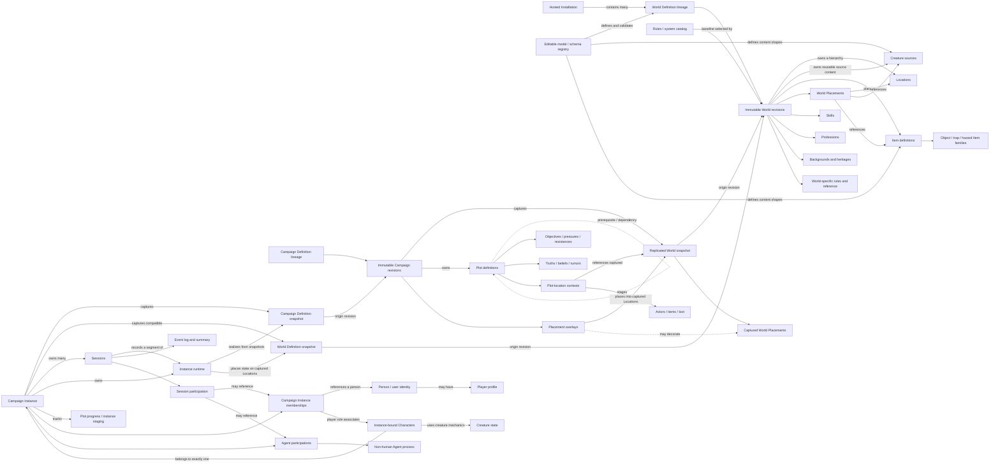

# Information architecture and domain model realignment

## Purpose and status

This document is the authoritative product information architecture and conceptual domain model for
Age of Wonders. It supersedes the singleton World/Campaign and blended authoring/play architecture
in the documents listed in `docs/README.md`'s exclusion registry. Implementation plans refine this
architecture but may not contradict it without an explicit architecture decision.

`packages/common/src/types` remains authoritative for the exact implemented TypeScript domain
contract. `apps/api/src/ai/prompts/domain-model.md` is the synchronized AI-facing representation of
that implemented contract. Where this architecture describes accepted work not yet implemented,
the gap must remain explicit rather than being filled by a deprecated requirement.

This architecture answers two questions:

1. How should the application organize setup, authoring, and game-time work?
2. What relationships must the data model represent so that the navigation reflects the actual
   product structure?

The central correction is that **Worlds**, **Campaigns**, and **Players** are peer structures. A
Campaign Definition lineage is based on a World lineage and each Definition revision captures a
World revision; it is not a mode, view, or live subset of that World. A Campaign Instance realizes
one captured Campaign Definition revision for an actual group and continuing history. A Player is
a person with a durable identity and server profile; they are not owned by a Campaign or Session.
Playable Characters and their histories belong to exactly one Campaign Instance. World-authored
NPC templates in the Codex are a separate authoring concept, as specified below. A Session belongs to a
Campaign Instance and records one period of play.

References across those boundaries are versioned snapshots, not live pointers. Each Campaign
Definition captures the World Definition revision against which it is authored, and each Campaign
Instance captures the Campaign Definition revision and World Definition revision against which it
runs. Upstream changes are offered as optional migrations; they never silently rewrite a downstream
Definition or running Instance.

The second central correction is that the documented leaves are editable seeds, not closed game
schema. The product must let authorized users extend the model itself—including concept types,
fields, relationships, vocabularies, and hierarchies—while preserving the small fixed spine needed
for ownership, identity, history, and authorization.

## Accepted Figma-led World UI update — 2026-10-11

The [Age of Wonders Figma document](https://www.figma.com/design/zRxEmjYZ0tuKOG9xj60Gtm/Age-of-Wonders?node-id=4-1667)
is authoritative for the current World authoring UI's presentation and visible navigation. Its
World overview, Atlas, Codex, Rule system, People & access, and Export world structure supersedes
prior UI navigation prescriptions for those surfaces, including the earlier mind-map-derived
visible site map. The broader ownership and runtime boundaries in this document remain valid.
Features absent from this design are excluded from the new view while their implementations and
data are preserved; they are not implicitly removed from the product model.

The user accepted responsive mobile layouts derived from the desktop designs, supporting flows
using the supplied page/form patterns, and account-name/password sign-in. Mobile navigation uses
a compact row with progressive disclosure rather than stacked persistent controls.

**Accepted World navigation simplification (2026-10-15):** The secondary navigation is
Atlas, Bestiary, Characters, Codex, Items, Overview, Rules, ordered alphabetically.
Codex has hierarchical left-nav children Backgrounds, Conditions, Effects, Professions
and Skills, also alphabetical, replacing
category tabs. Atlas contains all World locations; Rules consolidates the former Rule
system and World rules destinations. There is no Authoring libraries section.
Bestiary is the sole Creature listing/creation/editing destination; Characters owns
authored NPC templates. Old entry links remain compatible. Human remains a Creature
base, named humanoids are Characters, and Ionic Wight remains in Bestiary by decision.

Profession Rank, Equipment Slot, Attribute and Schema Structure definitions are outside
World editing scope and retained read-only. This does not freeze Character/Creature
attribute scores or equipment assignments. Separate Profession Rank authoring is removed;
folding its data into Profession definitions is a future model change, not an implicit
migration or deletion in this navigation task.

The Characters destination owns World-owned **Characters as NPC templates**, distinct from Campaign Instance
playable Characters and their histories. Each NPC template references a Creature Definition in
the same World and owns its editable authoring statistics. This does not move playable Character
ownership into the World or bypass versioned campaign capture.

**Conditions and Effects are reusable World-owned authoring definitions.** Conditions reference
Effects; each referenced modifier may permit an explicit Condition-specific value override.
Locations, Items, Creatures, and NPC templates grant Conditions through references. Shared
references must remain valid, and deletion must reject dangling dependencies. These authored
grants and durations do not themselves implement runtime application or countdowns. Existing
runtime Active Effects and captured rule execution remain distinct contracts.

**Accepted Location migration decision (2026-10-11):** Location relationships are hierarchical only.
Remove authored related-Location links and adjacency/travel-graph concepts; inter-Location travel is
roleplayed at the table. Parent/child containment and hierarchy position remain. Authored link UI/fields are removed; legacy travel resources remain read-only migration input. Retirement must
preserve previously captured data and distinguish travel from movement within a Location map.

See [Figma UI refactor](figma-ui-refactor.md) for implemented surfaces and the inventory of excluded
features with proposed future destinations. Those placement proposals are not yet accepted
requirements. The common TypeScript types remain authoritative for exact field shapes and the
AI-facing model guide must stay synchronized with those types.

## Authority and interpretation

The original conceptual analysis below used the following evidence order. For the current World
UI, apply the accepted Figma update above and the authority rules in `docs/README.md` first:

1. The supplied mind map and the accompanying direction are authoritative for concepts and
   hierarchy.
2. `packages/common/src/types` and `apps/api/src/domain/domain-resource.ts` supply relevant domain
   concepts that the diagram does not show.
3. The current web application, database schema, AI-facing domain guide, and existing documents
   provide implementation evidence and migration constraints.

Where the diagram contradicts current implementation or prior requirements, this architecture follows
the diagram and records the displaced decision. Where the diagram is silent, current concepts are
retained when they still serve the corrected hierarchy. The diagram is conceptual, so leaf labels
do not imply final storage fields, API resources, or one table per node.

## Authoritative hierarchy extracted from the mind map

The mind map establishes this product taxonomy:

```text
Age of Wonders
├── World
│   ├── Locations
│   │   ├── name, description
│   │   ├── items, creatures
│   │   └── map
│   │       ├── walls, lights, sounds, doors
│   │       ├── tokens, templates
│   │       └── orientation, weather, effects
│   ├── Creatures
│   │   ├── name, description, heritage, profession
│   │   ├── equipment
│   │   │   └── pack, belt, head, neck, off-hand, main-hand, chest,
│   │   │       arms, hands, legs, feet, fingers
│   │   ├── art
│   │   │   └── portrait, overhead token, side-on token
│   │   ├── attributes
│   │   │   └── might, intellect, wisdom, charisma, fortune, sanity, hardiness
│   │   ├── speed
│   │   │   └── walk, run, swim, fly, crawl, jump
│   │   └── skills
│   ├── Items
│   │   ├── base: value, rarity, name, durability
│   │   ├── weapon, armor, consumable/rations, tool
│   │   ├── accessories: ring, necklace, amulet
│   │   ├── containers: belt, pack
│   │   └── loot, currency, utility, material
│   ├── Skills
│   │   └── cooking, trapping, survival, lock picking, thievery,
│   │       persuasion, inspiration, performance
│   ├── Professions
│   │   ├── teacher: primary school, secondary school, community college, university
│   │   ├── soldier
│   │   │   ├── ground: rifleman/sniper, machinegunner/artillery,
│   │   │   │            flamethrower/arsonist, grenadier/demolitions
│   │   │   ├── sea: diver, submariner, deck hand
│   │   │   └── air: pilot, maintenance, flight crew
│   │   ├── criminal: street rat, gang member, crime boss, mafioso
│   │   ├── politician: mayor, council member, solicitor, senator, president
│   │   ├── tradesman: tanner, baker, butcher, blacksmith, metalworker,
│   │   │               fisherman, miner
│   │   ├── progression: novice, apprentice, journeyman, master, grand master
│   │   └── occultist
│   └── Background
├── Campaigns
│   ├── Plots
│   │   └── Plot
│   │       ├── subplots (recursive Plot hierarchy)
│   │       ├── name, description, objective, pressure, resistance
│   │       ├── discoveries: one truth + supporting/contradicting beliefs and rumors
│   │       └── location context: items, loot, actors
│   ├── Sessions
│   │   ├── date, time
│   │   ├── participants: players, spectators, agents
│   │   ├── event log
│   │   └── summary
│   ├── Players
│   └── Spectators
└── Players
    ├── email, phone, status, name
    └── characters
        └── creature with the player-character role
```

The diagram's named attributes, skills, professions, item categories, equipment locations, movement
modes, and similar leaves are editable seed content, not closed enumerations or a claim of
completeness. Their illustrated parent-child relationships establish the initial organization, but
authorized users can add peers and children at every content level—for example, an Attribute named
**Likeable** or an Equipment Slot named **Wings**.

The Campaigns branch spans two required data layers. Campaign Definition contains reusable authored
structure, especially Plots and preparation defaults. Campaign Instance contains an actual group's
Players/Spectators, Plot progress, Sessions, and continuing runtime. Session participants, event
log, and summary therefore belong to the Instance even though the diagram presents both layers
under the single Campaigns branch.

Plots are recursively hierarchical: a Plot may contain subplots, and each subplot is itself a full
Plot with the same possible children and content. This clarification is authoritative even though
the recursive edge was not legible in the original diagram.

## Product model

### Capability statement

Age of Wonders lets a GM establish a reusable World, author Campaign Definitions that reference
that World, create Campaign Instances for actual groups, manage durable Player and Character
identities, and conduct Sessions whose events change instance-specific play state without rewriting
the Campaign Definition or source World. It also lets authorized model authors extend the concepts,
fields, relationships, and vocabularies used by those records without changing application code.

### Actors

| Actor           | Primary needs                                                                                           | Primary surfaces                                       |
| --------------- | ------------------------------------------------------------------------------------------------------- | ------------------------------------------------------ |
| GM              | Establish source material, prepare plots and sessions, invite people, adjudicate play, preserve history | Home, Quick Start, Worlds, Campaigns, Players          |
| Player          | Maintain a profile and characters, join Campaign Instances and Sessions, control permitted characters   | Player portal, character creation, lobby, live Session |
| Spectator       | Join an invited Campaign Instance/Session and receive a constrained live projection                     | Invitation, lobby, spectator live view                 |
| Agent           | Observe and act on Campaign Instance state as a non-human process under explicit capabilities           | Instance integrations, agent roster, and bounded tools |
| System operator | Configure deployment, integrations, backups, AI, and health                                             | Setup and Settings/administration                      |

An Agent is a non-human process that participates in a Campaign Instance under explicit observation
and action capabilities. Examples include an AI assistant that suggests Plot twists or GM content
and an event-stream consumer that produces a narrative representation. An Agent is never silently
treated as a Player, Character, human identity, or unrestricted service account.

### Structural principles

- **World is source material.** It owns reusable setting content and the canonical location
  hierarchy.
- **Campaign Definition is authored use of a World.** It owns reusable premise, Plots, and
  preparation defaults, but no actual participants, Sessions, or mutable play history.
- **Campaign Instance is one played realization.** It captures one Campaign Definition revision and
  its compatible World revision, and owns roster/membership, Sessions, instantiated Plot progress,
  staging, and a continuing runtime.
- **Player is a durable person.** A Player profile records server standing and durable
  authentication identity independently of any one Campaign Instance membership.
- **Character is an Instance-bound creature role.** It uses creature mechanics and presentation,
  belongs to exactly one Campaign Instance, and is associated with a Player membership there.
- **Session is a bounded period of play.** It owns schedule, attendance, its event-log segment, and
  its summary; it belongs to a Campaign Instance and does not own or reset the World.
- **Live state is instance-specific.** Damage, inventory possession, token position, reveals,
  current time, travel, encounters, and other mutable facts must not leak between Campaign
  Instances using the same definition or World.
- **Snapshots isolate; migrations propagate.** A Campaign Definition owns a versioned, replicated
  snapshot of the World Definition it uses plus campaign-authored overlays. A Campaign Instance owns
  a versioned snapshot of both its Campaign Definition and resolved World Definition plus mutable
  runtime. Upstream changes enter either downstream scope only through an optional, reviewed
  migration that creates a new downstream revision.
- **World authoring, Campaign authoring, and play are separate experiences.** They use discrete
  workspace shells with explicit entry and exit. They may share design-system components and
  read projections, but they do not share an editing canvas, blended navigation state, or ambiguous
  save target. In-play improvisation creates Instance runtime content; changing World or Campaign
  Definition content requires an explicit transition out of Run into the appropriate authoring
  workspace.

### Open-by-default domain model

The domain model is authorable at every content level. Shipped concepts are starter definitions,
not the exhaustive structure of the game. A GM or other authorized model designer can create,
edit, organize, archive, and extend definitions through product UI without a code deployment or raw
JSON editing.

This applies at least to:

- attributes and their value/validation metadata;
- creature facets, classifications, art roles, movement modes, senses, and communication modes;
- equipment slots, slot groups, anatomy/applicability rules, item families, qualities, and
  capabilities;
- skills, professions, profession tiers/specializations, backgrounds, and heritages;
- location kinds, content roles, map layers/placeables/effects, connection kinds, and environment
  concepts;
- Plot, Discovery, Objective, Pressure, Resistance, Actor, Item, and Loot metadata or subtypes;
- reusable action, condition, trait, effect, hazard, discipline, language, and table definitions;
- additional fields and relationships on extensible content records.

The exact inventory of engine-critical closed vocabulary is deferred. Known fixed platform
semantics include stable identity, Definition versus Instance ownership, World → Campaign
Definition → Campaign Instance → Session reference direction, revision/history behavior,
authorization boundaries, and the value/schema primitives needed to validate data, but this is not
claimed to be exhaustive. Until the dedicated inventory is approved, the design remains open by
default: any proposed closed list must name its integrity or security rationale, and “not yet
modeled” never means “forbidden.”

Open extensibility requires first-class definitions, not arbitrary strings alone. A conceptual
model-definition registry provides:

| Definition kind               | Describes                                                                                               |
| ----------------------------- | ------------------------------------------------------------------------------------------------------- |
| Concept/type definition       | A named domain kind or taxonomy node, its parent, presentation, and capabilities                        |
| Field definition              | Stable key, human label, value type, cardinality, default, constraints, visibility, and editor behavior |
| Relationship definition       | Allowed source/target concepts, cardinality, inverse label, and reference semantics                     |
| Ordered vocabulary definition | User-editable choices such as attributes, movement modes, slots, tiers, and categories                  |
| Schema/version definition     | A coherent version of fields/relationships plus adoption and migration rules                            |

System-supplied seeds and World/Campaign-specific additions use stable, namespaced identities.
Every GM may edit schema definitions they created, subject to revision and in-use migration rules;
that authorship does not grant permission to alter system-, plugin-, or other-GM-authored schemas.
Renaming a label does not break references. Archiving an in-use definition preserves historical
values and prevents unintended new use; destructive removal requires dependency review and a
migration. New required fields need a default, derivation, or explicit backfill plan.

A Campaign Instance cannot create, extend, or override schemas. Its effective schema is the
compatible union selected by its captured World Definition and Campaign Definition revisions, and
all Instance records and runtime mutations must conform to it. Schema evolution reaches an Instance
only through the same all-or-nothing Definition migration used for other captured content.

Two examples define the expected capability:

- Creating the **Likeable** Attribute registers its identity, label, score/value rules, ordering,
  default or missing-value policy, and applicable creature schemas. Creature/Character editors,
  rules expressions, AI generation, validation, import/export, and existing-record migration all
  discover it from the active model rather than a compiled `AttributeCollection` field list.
- Creating the **Wings** Equipment Slot registers its identity, display group/order, capacity or
  occupancy rules, creature applicability, and compatible item capabilities. Creature equipment
  and item editors render it automatically, and runtime equip validation uses the definition rather
  than a hard-coded slot union.

Dynamic concepts must appear as native, human-readable controls throughout authoring and play. They
must not be relegated to an opaque “custom data” panel, and unknown-but-valid registered definitions
must round-trip through persistence, AI, graph projection, export/import, and older clients without
silent loss.

For computed fields, applicability checks, validation constraints, and completion predicates, this
proposal recommends a deliberately restricted profile of the [Common Expression Language
(CEL)](https://cel.dev/). CEL is designed for safe embedded expressions, is mutation-free and
non-Turing-complete, and evaluates only against data and functions supplied by the host. The product
profile must provide typed variables, publish-time parsing/type-checking, deterministic evaluation,
bounded cost, versioned allowlisted functions, and human-readable diagnostics. It must prohibit
network/filesystem access, state mutation, unseeded randomness, wall-clock dependence, dynamic code
loading, and arbitrary plugin execution. This recommendation governs schema expressions only; the
Rules execution model is defined below and in `age-of-wonders-rules-engine-design.md`.

### Versioned replication and optional migration

World and Campaign Definitions evolve through immutable published revisions. An editable draft or
authoring head may change freely, but any revision captured downstream remains immutable and
available for history, comparison, restoration, and migration.

The required replication chain is:

```text
World Definition lineage
└── World Definition revision W1
    └── replicated into Campaign Definition revision C1
        ├── captured World snapshot W1
        ├── Campaign-authored Plots and placement overlays
        └── replicated into Campaign Instance snapshot I1
            ├── captured Campaign Definition snapshot C1
            ├── captured World Definition snapshot W1
            └── Instance preparation, runtime, Sessions, and history

World Definition revision W2
└── optional World migration creates Campaign Definition revision C2
    ├── captured World snapshot W2
    ├── migrated Campaign Plots and placement overlays
    └── optional Campaign migration creates Campaign Instance snapshot I2
        ├── captured Campaign Definition snapshot C2
        ├── captured World Definition snapshot W2
        └── migrated Instance preparation and runtime
```

Replication is a behavioral ownership guarantee, not necessarily naïve byte-for-byte duplication.
Storage may deduplicate immutable content internally, but each Campaign Definition and Campaign
Instance independently owns its selected snapshot manifest, retains the exact resolved definitions
it depends on, and can remain on that snapshot indefinitely.

A Campaign Definition may place Creatures, Items—including Object, Trap, and Hazard Item
families—templates, or other registered content into Locations in its captured World snapshot to
support a Plot. These are Campaign-Definition-owned placement overlays. They reference or replicate
source content from the captured World revision but never mutate the World Definition, its Location
hierarchy, or its own placements. A Campaign Instance realizes selected definition placements as
instance state; moving, damaging, revealing, consuming, or removing a realized entity changes only
that Instance.

Migration is always optional and downstream:

- publishing a new World Definition revision does not change a Campaign Definition or Instance;
- a GM may migrate a Campaign Definition to a newer World revision, producing a new Campaign
  Definition revision while retaining the old one;
- when a Campaign Instance is created or migrated, it captures an immutable snapshot of the
  selected Campaign Definition revision—including its Plots, placement overlays, defaults, and
  other authored content—together with that revision's required World snapshot;
- all Instance preparation, runtime references, and Sessions created before the next explicit
  migration resolve against that captured Campaign Definition snapshot, not the Definition
  lineage's current authoring head;
- changing or migrating a Campaign Definition therefore does not change an existing Campaign
  Instance;
- a GM may migrate an Instance to a selected Campaign Definition revision, which also adopts the
  World snapshot required by that Campaign Definition revision;
- when World and Campaign Definition changes depend on one another, migration targets the compatible
  pair atomically rather than allowing a mixed, invalid combination;
- migration adopts the complete selected upstream revision and every required compatible
  dependency as one transaction; individual changes cannot be cherry-picked or partially applied;
- a migration follows the direct lineage of the existing World, Campaign Definition, or Instance
  snapshot and never merges sibling branches or jumps to an unrelated lineage;
- an Instance migration cannot begin while any Session is active;
- an Instance may remain pinned to its captured snapshots for its entire duration.

Every migration provides a dry-run comparison and an explicit migration plan. The plan maps stable
concept and record identities across source and target revisions, identifies added, changed,
archived, or missing Locations and content, previews effects on placement overlays and runtime
state, and requires the GM to resolve conflicts. Applying it is transactional or durably
recoverable, creates a new downstream revision/snapshot, preserves the prior snapshot, records an
audit trail, and supports rollback without losing later Session history. Conflict mapping makes the
complete target revision applicable; it does not select a subset of upstream changes.

Migration never equates records solely by display name. Stable lineage identity, declared
replacement relationships, and explicit GM mappings are authoritative. If a target revision removes
or changes something referenced by a Plot, placement, Character, runtime entity, or Session
history, the migration must preserve historical resolution and cannot silently drop or redirect the
reference.

## Proposed site map

### Global shell

The stable primary navigation should be:

```text
Home
Worlds
Campaigns
Players
Settings
```

Navigation maintains a stack of contextual ancestry frames. GM Workspace owns the primary
destinations above; Worlds and Campaigns have library frames, and selected Worlds, Campaign
Definitions, Instances, and individual records add their own named context. The left sidebar shows
one destination frame at a time; a record's property tabs do not create a new destination frame.
A link at the top names the preceding destination context (for example, “Back to GM Workspace” or
“Back to Worlds”) and navigates to it. Breadcrumbs beneath the page header expose the full ancestry and let
the GM pop several levels at once. The URL reconstructs this hierarchy on direct entry, refresh,
and browser history navigation; it does not depend on having visited the parent first. Mobile uses
the same destination navigation in the navigation drawer.

Navigation between records is distinct from navigation within a record. In World authoring, the
sidebar retains the owning World's destinations when a Location, Creature, Item, or other library
record is selected. The record's property groups appear as tabs inside its content view, beneath
the record title; they never replace the sidebar with a list of properties. Selecting another
record changes record context and breadcrumb ancestry. Selecting a property tab keeps the current
record and ancestry. On mobile, the shared tab row scrolls horizontally within the record content,
with at least 44 px touch targets; global destinations remain in the compact navigation drawer.
Tabs support keyboard focus and selection, with an explicitly associated content panel.

World Atlas is a section of the World frame. A selected Location has six local property tabs:
**Description**, **Map**, **Discoveries**, **Creatures**, **Items**, and **Connections**. Each tab
opens a distinct editing experience. Existing Location URLs remain directly addressable and retain
browser history and unsaved-change protection when switching tabs. Creature and Item property tabs
retain their mounted form values while switching groups; validation reveals the relevant tab.
Breadcrumbs identify record ancestry only, never the selected property group. Location ancestry follows the captured
containment relationships from the World root Location through each child, even on direct entry or
after reparenting. Connections exposes the parent and child Locations; selecting a child advances
record context. Map edits existing Location-owned image and scene data, with a preview, an
existing-media picker, upload, and explicit generation followed by Save Map. Description separates
player-facing prose from private GM notes; Discoveries authors truths, rumors, and beliefs.

Before minimum hosted-system readiness, the System Operator enters the separate Setup experience.
After readiness, Home may offer Quick Start until the GM dismisses or completes it; Quick Start is
not permanent primary navigation. Home also shows one **Continue** action for every active Campaign
Instance. Continue is dashboard content, not a global navigation destination.

The application has discrete workspace shells for World authoring, Campaign authoring, Campaign
Instance management, and Run. Moving between them is an explicit navigation transition, not a mode
change hidden inside a shared canvas. World authoring has only World context. Campaign Definition
authoring displays its captured World provenance and a read projection, but cannot edit the World.
Run displays its Campaign Instance, captured Definition and World versions, and active Session, but
contains no World or Campaign Definition authoring controls. Players, Settings, and incomplete
setup require no fabricated selection. The application never independently chooses the “latest”
World, Campaign Definition, or Campaign Instance. Worlds, Campaigns, and Players remain peer
destinations even if responsive presentation groups authoring destinations under a Build label.

### Setup experience

```text
Setup
└── Hosted system checklist
    ├── Establish first System Administrator
    │   ├── name, email, phone, and authentication identity
    │   └── optional GM capability
    ├── Deployment identity and public addresses
    ├── Additional operator access, authentication, and encryption readiness
    ├── Database and object storage
    ├── Plugins and external integrations
    ├── AI provider and model access
    ├── Email/SMS delivery
    ├── Backups, recovery, and host transfer
    └── Health, observability, and update readiness
```

Setup is exclusively a System Operator experience for making the hosted process safe and usable.
It does not create a World, Campaign Definition, Campaign Instance, Player, Character, or Session.
After initial readiness, these controls remain available under Settings / System.

The first launch establishes one System Administrator identity, including email and phone capture
and an authentication-provider association. That person may also hold the GM capability, but System
Administrator and GM remain distinct roles for authorization and audit. The hosted model is
single-tenant for one trusted group; multi-organization isolation is outside the intended scope.

`/setup` is the hosted-system checklist route, with deep links such as `/setup/hosting`,
`/setup/access`, `/setup/storage`, `/setup/plugins`, `/setup/integrations`, `/setup/ai`,
`/setup/communications`, `/setup/recovery`, and `/setup/operations`.

### Quick Start experience

```text
Home
└── Quick Start
    ├── Create or choose a World
    │   ├── identity and premise
    │   ├── rules/content baseline
    │   └── initial location hierarchy
    ├── Author first Campaign Definition
    │   ├── choose its World
    │   ├── Definition overview and first Plot
    │   └── starting location/context
    ├── Create first Campaign Instance
    │   ├── select its Campaign Definition
    │   └── initialize instance-specific starting state
    ├── Establish Players
    │   ├── create or invite people
    │   └── create/associate characters
    ├── Plan first Session
    │   ├── schedule and participants
    │   └── readiness review
    └── Enter lobby
```

Quick Start is a resumable product-onboarding checklist over the same records later edited in their
own workspaces. It must not create a parallel “wizard data” model and is available only after Setup
reaches minimum hosted-system readiness. It may be dismissed and reopened without affecting any
record. Returning users land on Home, where they deliberately choose Quick Start, a World task,
Campaign Definition, Campaign Instance, recent task, or active Session; the application does not
silently redirect to the most recently updated record.

Selecting a Quick Start activity opens the activity's canonical owning interface—not an embedded or
simplified substitute—with a persistent Quick Start guidance sidebar:

```text
Quick Start activity
└── Open canonical workspace and target record
    ├── World, Campaign Definition, Campaign Instance, Player, or Session interface
    └── Quick Start sidebar
        ├── activity purpose and expected outcome
        ├── task-specific instructions in the order they should be performed
        ├── required steps with not-started / current / complete / blocked state
        ├── live completion summary and explanation of anything still missing
        ├── contextual help and prerequisite/remediation links
        └── Back to Quick Start
```

The sidebar is the product tutorial. It describes how to use the actual interface currently beside
it and remains present while the GM follows routes that belong to that activity. It is guidance and
progress chrome only: it does not own a second form, proxy saves, or change the target workspace's
permissions and save semantics. The GM may collapse the sidebar without ending the activity and
reopen it from a visible **Quick Start guide** control. On narrow screens it becomes an accessible
drawer or step panel without covering the primary action.

Each required step has an explicit completion rule evaluated against authoritative application
state. For example, “Create the first Location” completes when the selected World contains a valid
Location, not merely when the GM visits the Location screen or clicks Save. Objective criteria
update automatically as the underlying records change. A qualitative learning step may require an
explicit GM confirmation, but it must be labeled as self-confirmed rather than presented as a
system-verified result. Blocked steps identify the unmet prerequisite and link to its owning
interface.

When the GM chooses **Back to Quick Start**, the checklist shows the activity's retained progress,
completed steps, remaining work, and next recommended activity. Returning to an incomplete activity
reopens the same selected record and canonical workspace when it still exists; otherwise Quick Start
asks for a new human-readable target. Quick Start completion state is per GM and may reference the
records used to satisfy it, but it never becomes ownership or lifecycle state on those domain
records.

Creating or deliberately choosing a World is Quick Start's initial content prerequisite. Campaign
Definition, Instance, Players, and first Session are progressive readiness milestones rather than
one all-or-nothing gate.

`/quick-start` is the checklist route, with activity routes such as
`/quick-start/activities/choose-or-create-world`, `/quick-start/activities/author-campaign`,
`/quick-start/activities/create-instance`, `/quick-start/activities/establish-players`, and
`/quick-start/activities/plan-session`. Launching an activity carries explicit guide, return, and
selected-target context into its canonical workspace route; the implementation may use navigation
state or a URL parameter, provided refresh/resume is reliable and the parameter cannot grant
authority. The application supports many Worlds, many Campaign Definitions, and many Campaign
Instances. Quick Start may create a new World or ask the GM to choose an existing one by name and
summary; it never chooses a World by recency.

### Hosted system setup and administration

Hosted configuration is a System Operator experience, not World or Campaign authoring. The same
areas appear in initial Setup as readiness tasks and later under Settings for maintenance. This is
a starting set rather than a closed inventory:

```text
Settings
└── System
    ├── Overview & readiness
    │   ├── application version and deployment identity
    │   ├── liveness, readiness, dependency status, and degraded capabilities
    │   └── pending restart, migration, update, or security actions
    ├── Hosting & network
    │   ├── installation name, public web/API addresses, locale, and time zone
    │   ├── trusted origins, reverse-proxy/TLS status, and invitation-link base address
    │   └── ports and environment-owned values (read-only when deployment-managed)
    ├── Access & security
    │   ├── bootstrap completion and System Operator accounts
    │   ├── authentication providers, session policy, and optional SSO/OIDC
    │   ├── roles, capabilities, API clients, service accounts, and access tokens
    │   ├── contact-data encryption status and key-rotation workflow
    │   └── security events, credential expiry, and emergency access/revocation
    ├── Plugins
    │   ├── catalog/approved sources and installed plugins
    │   ├── enable, disable, update, rollback, and uninstall
    │   ├── compatibility, dependencies, requested permissions, and data access
    │   ├── plugin configuration and secret references
    │   └── plugin health, logs, and audit history
    ├── Integrations & API credentials
    │   ├── configured providers and connection status
    │   ├── outbound credentials, scopes, quotas, and rotation
    │   ├── inbound API clients and scoped keys
    │   ├── webhooks, callback addresses, signing secrets, and delivery history
    │   └── test connection / send test event without revealing secrets
    ├── AI
    │   ├── providers, API-key references, available models, and default model
    │   ├── feature-specific model selection and fallback policy
    │   ├── budgets, quotas, rate limits, timeouts, and retry policy
    │   ├── prompt/output access, redaction, retention, and deletion policy
    │   └── usage, cost, latency, failure, and provider-status reporting
    ├── Communications
    │   ├── email provider, sender identity/domain, and test/capture mode
    │   ├── SMS provider, sending number, and test/capture mode
    │   ├── invitation-link lifetime, templates, delivery defaults, and suppression
    │   └── test delivery, bounce/failure status, and provider health
    ├── Data & storage
    │   ├── database connection/readiness and schema-migration status
    │   ├── S3-compatible endpoint, region, bucket, credential reference, and health
    │   ├── media limits, quotas, accepted content, scanning, and orphan repair
    │   ├── graph/index projection backlog, drift, rebuild, and reconciliation
    │   └── capacity, retention, and data-integrity status
    ├── Backup, recovery & transfer
    │   ├── backup schedule, triggers, destination, encryption, and retention
    │   ├── backup inventory, verification, restore drill, and recovery objectives
    │   ├── restore/rollback workflow with impact preview and maintenance gate
    │   └── host export/import, checksums, compatibility, and conflict handling
    ├── Operations
    │   ├── logs, metrics, traces, request correlation, dashboards, and alerts
    │   ├── background jobs, failed work, retry/dead-letter controls, and queues
    │   ├── rate limits, abuse controls, concurrency limits, and maintenance mode
    │   └── diagnostics bundle and support-safe redaction
    ├── Privacy & data governance
    │   ├── participant PII, AI history, audit, Session, and media retention
    │   ├── consent/notices, data export, correction, and deletion workflows
    │   └── audit-log access, immutable security events, and redaction policy
    └── Updates & lifecycle
        ├── current/recommended version and compatibility report
        ├── release notes, plugin compatibility, and migration preflight
        ├── backup-before-update, staged update, rollback/forward-fix
        └── restart and maintenance-window coordination
```

The UI classifies every setting so the operator knows how it takes effect:

- **Application-managed:** safely editable and validated in the UI, with audit history.
- **Secret-backed:** entered or selected through a secret store, masked after save, never returned to
  the browser or logs, and rotatable without exposing the prior value.
- **Deployment-managed:** supplied by environment, container/orchestrator, or mounted configuration;
  shown as source/status with instructions and restart impact rather than falsely editable.
- **Observed:** computed health, capacity, version, or drift state; read-only with diagnostics and
  an authorized remediation action where one exists.

Setup distinguishes blocking readiness from optional capability. Database, schema, public URL,
authentication, encryption, and required storage failures block hosted operation. AI, SMS, email,
webhooks, and individual plugins may be disabled deliberately, but features depending on them show
that limitation before a user enters the affected workflow. No setup screen displays a saved API
key, token, encryption key, database password, or plugin secret after submission.

### World authoring

```text
Worlds
├── World library
│   ├── browse, search, sort, and recent Worlds
│   ├── create, import, duplicate/fork, archive, and restore
│   └── readiness, current revision, and downstream usage summary
└── World
    ├── Overview
    ├── Versions
    │   ├── authoring draft
    │   ├── published revisions
    │   └── downstream migration availability
    ├── Locations
    │   ├── Location hierarchy
    │   │   └── Location
    │   │       ├── Overview
    │   │       ├── Map
    │   │       │   ├── orientation and base imagery
    │   │       │   ├── walls and doors
    │   │       │   ├── lights and sounds
    │   │       │   ├── tokens and templates
    │   │       │   └── weather and effects
    │   │       ├── Contents
    │   │       │   ├── creatures/actors
    │   │       │   └── items (including loot, objects, traps, and hazards)
    │   │       └── Connections
    │   └── location/map taxonomies (advanced)
    ├── Bestiary
    │   ├── browse and search creatures
    │   ├── creature builder: identity, heritage, profession, equipment,
    │   │   art, attributes, speeds, skills, and supporting rules
    │   └── creature taxonomies (advanced)
    ├── Items
    │   ├── browse and search items
    │   ├── weapons, armor, consumables, tools, accessories, and containers
    │   ├── loot, currency, utility items, and materials
    │   ├── objects, traps, and hazards as Item families
    │   └── item families, properties, and taxonomies (advanced)
    ├── Skills
    ├── Professions
    │   └── Overview and Modifiers tabs
    ├── Backgrounds
    │   └── Overview and Modifiers tabs
    ├── Models & taxonomies
    │   ├── Overview
    │   ├── Schema structure
    │   ├── Attributes
    │   ├── Equipment slots
    │   └── Profession ranks
    └── Codex
        └── World rules authoring
```

The map belongs to its Location as the diagram specifies. A runtime scene can stage an encounter on
that map, but must not become the competing owner of the location's map, walls, doors, orientation,
or source presentation.

Every valid Location must have a map. Preserve image and isometric formats; legacy mapless drafts
must be repairable but cannot satisfy validity/publication. Preserve the existing scene/grid
configuration, including square/hex pixel grids; scenic maps do not render or use grids. Retain
configuration when changing orientation, and keep image pixels distinct from terrain cell units.
`LocationDefinition` owns authored state, with World scope supplied through context. Private GM
fields remain private. B09 implements authored weather and named asset-backed audiovisual
presentation defaults, captured as World data. B10 adds Instance-local weather overrides and explicit local GM playback controls. Automatic scheduling and synchronized participant playback remain outside the existing-execution cutover.
These are presentation settings, separate from mechanical Conditions/Effects.
These requirements are implemented in Location authoring and publication. Initial World-root
drafts may remain incomplete until mapped. Map/Wall/Door/Window ownership preserves the existing
2D and 3D representations; Instance runtime realization remains pending. Legacy travel resources remain readable with new writes disabled.

World authoring now uses an executable `WorldDefinition` class for revision-content membership,
capture requirements, root and hierarchy consistency, and World Placement reference policy. Child
entities retain their own validation. The adapter binds child diagnostics to the exact content and
capture, and publication reads aggregate World state validity. Captured records remain authorized
context; repository transactions persist content and captures together. The common `WorldDefinition`
lineage metadata contract is unchanged; lineage lifecycle and runtime World migration remain pending.

Isometric is a Map orientation alongside Scenic, Overhead, and Side-on. Selecting it opens manual terrain authoring with optional generation; it is not a separate Location option.
Accepted isometric-map target behavior is specified in [the isometric maps design](isometric-maps-design.md).
Location-owned terrain uses at most 100 cells per axis with five-foot cell edges. Its authoring
experience includes weighted random generation and arbitrary selection edits/removal. Interactive
views remain centered on a selected actor; a player is restricted to their bound actor. Captured
source terrain stays immutable during play, and Instance runtime owns opening-state changes and
exploration. The shared terrain foundation, Location-owned manifest/chunk capture, and initial 3D GM editor
are implemented. World authoring exposes the full source geometry only to its owning GM. Spatial
Instance actor setup, Player Character binding, shared 3D sight facts, internal redacted projections, and observer exploration snapshot helpers are implemented. Transactional exploration storage is implemented. Checkpoint capture and predecessor-checkpoint exploration recovery are implemented. Authoritative rules evaluation and gameplay integration remain pending. Versioned built-in PBR texture sets and device quality controls are implemented; custom material assets remain pending. Vertical work planes and normal-only smoothing are implemented. Door/window authoring and procedural presentation are implemented.

Within a selected World workspace reached through **Worlds**, secondary navigation is a flat
list: **Overview**, **Locations**, **Bestiary**, **Items**, **Skills**, **Professions**,
**Backgrounds**, **Models & taxonomies**, **Codex**, and **Versions**. Each destination directly
opens its editor or library. The selected destination stays highlighted when viewing its records.
Existing Atlas, Item Compendium, Characters, and Rules URL segments retain their route contracts;
the visible labels and flat presentation do not change aggregate ownership. Objects, traps, and
hazards remain Item families or capabilities, not separate top-level libraries.

Multiple facets of a record or model workspace appear as tabs in the content area, following the
Location property-tab pattern. Switching local form tabs preserves unsaved values. Single-facet
editors do not need artificial tabs. Contextual model links remain available in applicable editors.

The desktop secondary panel is horizontally resizable by dragging its divider or using the keyboard
(Left/Right, Home/End). Its preferred width persists locally, defaults to 224 px, and is bounded to
200–400 px with an additional viewport bound to preserve content space. Mobile exposes the same
flat destinations in the navigation drawer, with a single compact navigation row and touch targets
of at least 44 px. Closing the drawer preserves the current editor and its state.

### Campaign authoring

```text
Campaigns
├── Definitions
│   └── Campaign Definition
│       ├── Overview
│       │   ├── referenced World
│       │   └── GM premise and player-safe introduction
│       ├── Plots
│       │   └── Plot Definition
│       │       ├── Subplots
│       │       │   └── Plot Definition (recursive)
│       │       ├── name and description
│       │       ├── objectives, pressures, and resistances
│       │       ├── discoveries: one truth with supporting/contradicting beliefs and rumors
│       │       └── location contexts: actors, items, and loot
│       ├── Placements
│       │   ├── Creatures and Items, including Object/Trap/Hazard families
│       │   ├── independent Campaign placements
│       │   ├── decorations of captured World Placements
│       │   └── Plot and captured-World Location associations
│       ├── Preparation defaults
│       │   ├── starting context
│       │   └── reusable staging and source-map variations
│       ├── Versions & migrations
│       │   ├── captured World Definition snapshot
│       │   ├── compare available World revisions
│       │   └── dry run / migrate to new Campaign Definition revision
│       └── Create Campaign Instance
└── Instances
    └── Campaign Instance
        ├── Overview and readiness
        │   └── referenced Campaign Definition and World
        ├── Plot state and instance-specific staging
        ├── Definition placements and realized Instance state
        ├── Roster
        │   ├── players and active characters
        │   ├── spectators
        │   ├── non-human agents and observe/act capabilities
        │   └── memberships, invitations, and readiness
        ├── Sessions
        │   ├── planned
        │   ├── current
        │   └── history and summaries
        ├── Versions & migrations
        │   ├── captured Campaign and World snapshots
        │   ├── compare compatible Definition revisions
        │   └── dry run / migrate Instance snapshot
        └── Continue campaign
            └── readiness gate / resume current Session
```

Campaign Definition Plot locations and placement overlays reference Locations/content in the
Definition's captured World snapshot. Definition preparation holds reusable defaults. A Campaign
Instance captures and realizes those defaults and owns actual roster, staging, Plot progress,
Sessions, and runtime state. **Open in World Authoring** and **Open in Campaign Authoring** leave the
current workspace and open the corresponding separate editor; they are never inline editing modes.
An Instance may stage actors, items, loot, discoveries, weather variations, or other overlays
without taking ownership of the World or Campaign Definition records.

### Players

```text
Players
├── Directory
└── Player
    ├── profile: name, server status, email, phone, authentication identity
    ├── Campaign Instance memberships
    ├── session activity
    └── characters by Campaign Instance
        └── Instance-bound Character
            ├── creature sheet and art
            ├── heritage, profession, and background
            ├── attributes, speeds, skills, and equipment
            ├── owning Campaign Instance and status
            └── optional one-way import provenance
```

Contact data remains protected and is shown only to authorized people. All visible references use
human-readable names or neutral fallbacks; opaque IDs may appear in URLs but never as labels.
Player status records the person's standing with the server, such as active, inactive, or banned;
it is separate from Campaign membership and Session attendance. A profile is created through an
invitation-driven onboarding flow and linked to the durable identity supplied by the configured
authentication provider; it is not later “claimed” through heuristic matching. The Auth0 adapter
preserves that boundary through explicit linking and exact provider-subject lookup.

A durable authenticated person may exist only as a Spectator, outside any Campaign Instance, but
may observe a Campaign Instance only after an explicit Campaign Instance invitation. Player and
Spectator Campaign relationships are durable Instance memberships; attendance remains a separate
Session record.

### Game-time experience

Starting or resuming a session changes the shell from authoring to an operational Run experience:

```text
Run / active Campaign Instance / active Session
├── Lobby and readiness
├── Table / current Location map
├── Party and participants
├── Plot cues and discoveries
├── Encounter and adjudication
├── Event log
└── End session
    ├── review event segment
    ├── write/approve summary
    └── return to Campaign Instance / Sessions
```

Navigation and cards use **Continue** or **Resume** while referring to a Campaign Instance or
Session that is not currently open. **Run** names only the operational game-time workspace after the
GM has selected the Instance and Session. A Campaign is therefore continued or resumed; it is not
presented as something to “run” from a library or chooser.

The Run experience prioritizes current context, participant state, fast adjudication, and safe
runtime mutation. It offers no World or Campaign Definition authoring controls. In-context **Create
and place** creates explicitly labeled Instance runtime content only. **Open World Authoring** and
**Open Campaign Authoring** are navigation exits that preserve a return-to-Run affordance; they do
not embed those editors in Run. **Prepare Instance** leaves Run for the distinct Campaign Instance
management workspace. Starting a Session must pass a readiness and pending-save gate.

When the GM exits a live Session for an authoring workspace, a persistent **Session live / Return to
Run** banner preserves orientation, but the authoring workspace remains structurally separate.
Saving or publishing a World or Campaign Definition change never alters the active Instance. The
Run continues against its captured snapshots until the GM explicitly performs an Instance
migration. The Instance cannot migrate while a Session is active; the GM must end or pause/close the
Session so it is no longer active before migration can begin. Migration can never occur as an
incidental save side effect.

The default Home dashboard shows a separate **Continue** action for every active Campaign Instance,
and each Campaign Instance page exposes the same action for itself. Continue opens or deliberately
selects that Instance's resumable Session; it never chooses a Campaign Instance by recency. If the
Instance has no resumable Session, the action explains whether the next step is to resume a paused
Session, plan a Session, or open its lobby.
`/campaigns/instances/:campaignInstanceId/run/:sessionId` is the canonical operational route after
selection. Completed or cancelled Sessions redirect to their Session record/recap and cannot
reopen a live mutation surface.

Player and spectator experiences are separate projections:

```text
Player portal
├── My Campaign Instances
│   └── Instance-bound characters / character creation
├── Invitations and upcoming sessions
└── Lobby / permitted live controls

Spectator portal
├── Invitation
├── Lobby
└── Spectator-safe live view and spectator channel
```

### Route design direction

Routes should encode ownership and context. The final router may vary, but it should follow these
shapes:

```text
/setup
/setup/:systemArea
/quick-start
/quick-start/activities/:activityKey

/worlds
/worlds/:worldId
/worlds/:worldId/versions
/worlds/:worldId/atlas
/worlds/:worldId/atlas/locations/:locationId
/worlds/:worldId/bestiary
/worlds/:worldId/bestiary/creatures/:creatureId
/worlds/:worldId/item-compendium
/worlds/:worldId/item-compendium/items/:itemId
/worlds/:worldId/characters
/worlds/:worldId/characters/heritages/:heritageId
/worlds/:worldId/characters/skills/:skillId
/worlds/:worldId/characters/professions/:professionId
/worlds/:worldId/characters/backgrounds/:backgroundId
/worlds/:worldId/characters/model/:definitionKind/:definitionId
/worlds/:worldId/rules

/campaigns
/campaigns/definitions/:campaignDefinitionId
/campaigns/definitions/:campaignDefinitionId/plots/:plotDefinitionId
/campaigns/definitions/:campaignDefinitionId/placements
/campaigns/definitions/:campaignDefinitionId/preparation
/campaigns/definitions/:campaignDefinitionId/versions
/campaigns/instances/:campaignInstanceId
/campaigns/instances/:campaignInstanceId/roster
/campaigns/instances/:campaignInstanceId/characters/:characterId
/campaigns/instances/:campaignInstanceId/agents/:agentId
/campaigns/instances/:campaignInstanceId/sessions/:sessionId
/campaigns/instances/:campaignInstanceId/migrations
/campaigns/instances/:campaignInstanceId/run/:sessionId

/players
/players/:playerId

/play
/play/instances/:campaignInstanceId/characters
/play/instances/:campaignInstanceId/characters/:characterId
/play/instances/:campaignInstanceId/sessions/:sessionId
/join/...

/settings/system
/settings/system/:systemArea
```

Legacy singular `/world/...` and flat resource routes can redirect to the explicit selected-World
routes during migration. A redirect may preserve a known World context, but it cannot guess among
multiple Worlds by recency; ambiguous legacy links open the World chooser with a human-readable
explanation.

## Experience requirements

- **IA-001:** Worlds, Campaigns, and Players are peer structures in the product model and primary
  navigation. Worlds opens a library/chooser before entering a selected World workspace.
- **IA-002:** Campaign Definition and Instance selection always derive their referenced World
  context; the application never combines unrelated records selected by independent “most recent”
  queries.
- **IA-003:** Sessions are navigated within a Campaign Instance, never under a Campaign Definition
  or as an unscoped global journal.
- **IA-004:** Location navigation is part of the World Atlas. Campaign Definition Plot context and
  Instance staging/Run context are reached through their owning surfaces and do not masquerade as
  the World editor.
- **IA-005:** Setup, Quick Start, World authoring, Campaign authoring, Campaign Instance management,
  and Run are discrete user experiences with explicit transitions between them.
- **IA-006:** Run and authoring use separate workspace shells and navigation state. They may share
  underlying components and read projections, but never an editing canvas, save target, command
  set, or implicit mode switch.
- **IA-007:** Home presents deliberate choices and actionable readiness. It does not automatically
  open the latest Campaign Definition, Campaign Instance, or Location.
- **IA-008:** World, Campaign Definition, and Campaign Instance surfaces provide reciprocal
  contextual links with captured-version provenance and without obscuring ownership.
- **IA-009:** Player, spectator, agent, and GM capabilities are enforced by server projections and
  authorization, not only hidden controls.
- **IA-010:** The current context is always legible by human-readable World, Campaign Definition,
  Campaign Instance, Plot, Location, and Session names.
- **IA-011:** Player contact information is protected; opaque identifiers are never used as visible
  fallback labels.
- **IA-012:** Mobile navigation preserves the same hierarchy and context rather than flattening
  resources into an unrelated drawer list.
- **IA-013:** World source content, Campaign Definition authoring/defaults, Campaign Instance
  preparation/runtime, and Session live/journal state are named ownership layers with an explicit
  snapshot, overlay, projection, and migration policy.
- **IA-014:** Entering Run always requires an explicit Campaign Instance and Session. Zero, one, or
  many candidates never changes that selection rule.
- **IA-015:** Authoring opened during live play preserves a persistent return path and explains when
  saved upstream changes become migration candidates; they do not affect the live Session
  automatically.
- **IA-016:** A Session record route owns planning, attendance, recap, and read-only history; its Run
  route exists only while operational mutation is valid.
- **IA-017:** Campaign Definition Plots are navigated as a recursive tree. The UI exposes parent
  context, child subplots, and stable direct links without flattening subplots into unrelated root
  records.
- **IA-018:** Every editable domain concept has a discoverable authoring surface and can also be
  reached contextually from records that use it.
- **IA-019:** Creating or editing model definitions updates applicable editors, pickers, validation,
  AI context, and runtime rules without requiring users to manipulate raw JSON.
- **IA-020:** Interfaces distinguish editing a record value from editing the model that defines the
  field, vocabulary, or relationship, and show the scope and impact of each action.
- **IA-021:** Campaign Definition placement authoring lets a GM place Creatures, Items—including
  Object, Trap, and Hazard families—and other registered placeables into Locations of the captured
  World snapshot and associate them with Plots without modifying the World Definition.
- **IA-022:** World, Campaign Definition, and Campaign Instance surfaces show their current snapshot
  revision, available compatible upstream revisions, and whether migration is available.
- **IA-023:** Migration begins with a readable comparison and dry run, groups conflicts by affected
  Plot/Location/content/runtime context, and never requires the GM to interpret opaque IDs.
- **IA-024:** The GM may migrate the complete upstream revision, provide mappings required to make
  that complete revision compatible, defer it, or reject it. Individual upstream changes cannot be
  cherry-picked. Deferring leaves the current snapshot fully operational and does not repeatedly
  alter it in the background.
- **IA-025:** A successful migration creates a new downstream revision/snapshot with audit and
  rollback access; the pre-migration version remains inspectable.
- **IA-026:** Run permits only Campaign Instance runtime mutations. Editing World or Campaign
  Definition content requires leaving Run for the corresponding authoring workspace, while a
  persistent return path preserves live-session context.
- **IA-027:** Home shows one **Continue** action for every active Campaign Instance, and each
  Campaign Instance page shows its own Continue action. Existing Session entry points use
  **Continue** or **Resume**; **Run** is reserved for the operational workspace after the GM has
  deliberately selected the Instance and Session. Continue is not primary navigation.
- **IA-028:** Setup contains only hosted-system configuration and readiness. Quick Start contains
  the World, Campaign Definition, Campaign Instance, Player, Character, and first-Session onboarding
  checklist and writes directly to those records through their owning workspaces.
- **IA-029:** Setup and Settings / System surface hosting/network, access/security, plugins,
  integrations/API credentials, AI, communications, data/storage, backup/recovery/transfer,
  operations, privacy/governance, and updates/lifecycle as an extensible starting taxonomy.
- **IA-030:** Every system setting identifies whether it is application-managed, secret-backed,
  deployment-managed, or observed, plus its source, validation state, effective value description,
  affected capabilities, and whether applying a change requires reconnection, restart, or
  maintenance.
- **IA-031:** Secret values are write-only after entry. The UI exposes presence, source, owner,
  expiry, last rotation, validation status, and rotate/revoke actions without returning the stored
  value to the browser, logs, diagnostics, exports, or AI context.
- **IA-032:** Plugin installation and updates require compatibility and permission review. Enable,
  disable, upgrade, rollback, and uninstall operations show affected capabilities/data, preserve an
  audit trail, and cannot silently expand permissions.
- **IA-033:** Readiness distinguishes required dependencies from intentionally disabled optional
  capabilities. A disabled or unhealthy integration is explained at Setup, Settings, and every
  dependent workflow before the user commits work that requires it.
- **IA-034:** Provider and infrastructure configuration supports a non-destructive validation or
  test action where feasible, with human-readable results, timestamps, and request correlation but
  no secret disclosure.
- **IA-035:** Invoking a Quick Start activity navigates to the canonical owning World, Campaign
  Definition, Campaign Instance, Player, or Session interface with explicit selected-record and
  return context; it never opens a duplicate tutorial editor.
- **IA-036:** The launched interface presents a Quick Start sidebar containing the activity's
  purpose, task-specific instructions, ordered required steps, current progress, missing or blocked
  requirements, contextual help, and a persistent **Back to Quick Start** action.
- **IA-037:** Quick Start guidance never changes the owning interface's authorization, validation,
  save semantics, or ownership boundary. All record mutation occurs through the normal workspace
  controls.
- **IA-038:** System-verifiable Quick Start steps derive completion from authoritative domain state
  and update as that state changes. Visiting a route, opening a control, or clicking Save is not by
  itself evidence of completion.
- **IA-039:** A qualitative step may use explicit GM confirmation only when no reliable state
  predicate exists, and the UI distinguishes self-confirmed completion from system verification.
- **IA-040:** The sidebar remains present through the routes required by its activity, can be
  collapsed and restored, survives refresh, and adapts to an accessible drawer or step panel on
  narrow screens.
- **IA-041:** Returning to Quick Start preserves per-GM activity/step progress and identifies the
  records used to satisfy the activity by human-readable labels. Missing or inaccessible targets
  trigger reselection or remediation without exposing opaque identifiers.
- **IA-042:** Quick Start can recommend a next activity but cannot silently navigate, create
  records, choose among multiple eligible records, or mark an unmet requirement complete.
- **IA-043:** World secondary navigation is a flat list of Overview, Locations, Bestiary, Items,
  Skills, Professions, Backgrounds, Models & taxonomies, Codex, and Versions. These destinations
  do not introduce new ownership boundaries.
- **IA-044:** Skills, Professions, Backgrounds, and Models & taxonomies are direct World
  destinations. Items includes Objects, Traps, and Hazards as Item families or capabilities.
- **IA-045:** World records with multiple facets expose those facets as content tabs. The secondary
  navigation retains the owning World destinations and highlights the active library.
- **IA-046:** The desktop secondary panel supports pointer and keyboard horizontal resizing with a
  persisted, bounded width. Mobile uses the same flat destinations in the compact navigation drawer.
- **IA-047:** Landing pages emphasize browse/search and a primary creation action. Model facets use
  content tabs; contextual model links remain available from applicable editors.
- **IA-048:** An Installation supports multiple World Definition lineages. Worlds provides explicit
  create, import, duplicate/fork, archive, restore, browse, search, and selection workflows with
  human-readable readiness, revision, and downstream-usage summaries.
- **IA-049:** Entering World authoring requires an explicit selected World. Its name and revision
  context remain visible throughout Atlas, Bestiary, Item Compendium, Characters, and Rules; the
  application never selects or switches Worlds by recency.
- **IA-050:** Campaign Definition creation explicitly selects a World lineage and starting World
  revision. Campaign authoring subsequently displays captured-World provenance and cannot inherit
  an unrelated World merely because the GM last visited it.
- **IA-051:** Switching World workspaces clears or re-resolves World-scoped selections. Location,
  Creature, Item, Character-model, and Rule references from one World cannot silently appear as
  editable records in another.
- **IA-052:** Home renders a distinct Continue card/action for every active Campaign Instance. The
  Campaign Instance page repeats that action for its own context; neither surface infers a different
  Instance from recency.
- **IA-053:** Migration controls are disabled while a Session is active and explain that the Session
  must cease being active. A migration preview always represents the complete target revision and
  required compatible dependencies, never a selectable list of changes.
- **IA-054:** Quick Start adopts a newly released Activity Definition immediately, reevaluates
  completion, maps compatible progress, and visibly reopens changed or newly required steps.
- **IA-055:** Rules is exposed through the visible Codex World destination; its internal
  execution semantics follow the event-driven rules architecture below. Detailed authoring UI and
  runtime contracts are developed in the dedicated Rules design.
- **IA-056:** Plugin authoring and release versioning occur outside every Installation, World, and
  Campaign workspace. Setup manages installation and permissions; World and Campaign authoring
  surfaces manage only explicit adoption of plugin-provided content or capabilities.
- **IA-057:** First-launch Setup establishes one System Administrator identity, including email,
  phone, and authentication-provider association, for a single-tenant trusted-group Installation.
  Assigning that person a GM role does not merge the roles or their audit trails.
- **IA-058:** Player and Spectator access begins with an invitation. Campaign Instance pages show
  durable membership separately from Session attendance, and no profile-claiming or heuristic
  identity-matching workflow is presented.
- **IA-059:** Campaign Instance management includes an Agent roster where authorized users can grant,
  inspect, pause, and revoke explicit observation/action capabilities for non-human participants;
  Session views expose their auditable activity separately from human attendance.
- **IA-060:** The Installation may expose many active Campaign Instances at once, but every
  start/resume control must enforce the single globally active Session constraint and identify the
  already-active Session by human-readable context when blocked.

### Permission and projection baseline

| Role               | May change                                                                                                                                                                                        | May see                                                                                                                                            |
| ------------------ | ------------------------------------------------------------------------------------------------------------------------------------------------------------------------------------------------- | -------------------------------------------------------------------------------------------------------------------------------------------------- |
| GM author/operator | Domain model/taxonomy definitions in authorized scopes; World source content; Campaign Definitions; Campaign Instances; invitations; approved character state; Session lifecycle and adjudication | Full authorized World/Definition/Instance state, protected Plot cues, unrevealed knowledge, plans, logs, and participant administration            |
| Player             | Own profile/contact data; author permitted drafts and choices for Characters bound to an Instance; controlled live plans/actions                                                                  | Player-safe Definition/Instance introduction, associated Instance Characters, revealed knowledge, permitted World context, published Session state |
| Spectator          | Local viewpoint and spectator-channel participation only                                                                                                                                          | Spectator-safe Instance/Session projection, receive-only media, and spectator channel; no unrevealed authoring or player-only controls             |
| Agent              | Only explicitly granted, auditable actions; never implicit player impersonation                                                                                                                   | Only fields allowed by its Instance/Session capability and visibility grant                                                                        |
| System operator    | Deployment, integration, plugin, credential, recovery, and audit operations rather than narrative authorship                                                                                      | The minimum PII, AI provenance, configuration metadata, backups, health, and audit data required for operation                                     |

Campaign Instance- and Session-invitation create/revoke/retry, lobby start/cancel, Session end, and summary
approval/publication require explicit authority. Ejecting someone from a Session and banning them
from an Instance are different actions. Server projections protect GM premise, Plot mechanics,
unrevealed Truth/Belief/Rumor content, private plans, participant contact data, and source-versus-live
detail. A person may hold different roles in different Campaign Instances or Sessions.
Publishing Definition revisions, constructing migration mappings, applying migrations, and rolling
back snapshot adoption are separately auditable GM/model-author capabilities.

## Conceptual data model

### Bounded contexts and ownership

| Context                   | Owns                                                                                                                                                                        | References but does not own                                                                            |
| ------------------------- | --------------------------------------------------------------------------------------------------------------------------------------------------------------------------- | ------------------------------------------------------------------------------------------------------ |
| Guidance/onboarding       | versioned Quick Start activity definitions and per-GM activity/step progress                                                                                                | target routes, completion predicates, and records used as evidence                                     |
| Hosted system             | installation identity, configuration metadata, readiness policy, operator capabilities, plugin installations, integration connections, backup policy, operational audit     | many World Definition lineages, secret references, deployment environment, infrastructure dependencies |
| Identity                  | users, player profiles, server standing, protected contact methods, authentication-provider associations                                                                    | campaign memberships and invitation-driven onboarding                                                  |
| Model/schema              | concept, field, relationship, vocabulary, and schema-version definitions; dependencies and migration metadata                                                               | system seeds and records governed by each adopted model version                                        |
| Rules/system              | engine editions, shared content packs, variants, extension schemas, reusable base definitions                                                                               | none of the World/Campaign Instance runtime state                                                      |
| World Definition          | logical lineage and immutable revisions of the location tree, maps, setting content, model adoption, and curated rules baseline                                             | shared rules/system catalog, media assets, external provenance                                         |
| Campaign Definition       | logical lineage/revisions, captured World snapshot, recursive Plots, campaign placement overlays, preparation defaults, migration history                                   | its selected World Definition lineage/revision                                                         |
| Campaign Instance         | captured Campaign/World snapshots, human memberships/invitations, Agent capabilities, bound Characters, Plot progress, staging, lifecycle, migration history                | one Campaign Definition lineage, compatible revision pair, durable identities                          |
| Campaign Instance runtime | campaign clock, instantiated actors/items/objects, placement and possession, party state, reveals, fog knowledge, active scene/encounter, downtime/travel/rest/social state | the Instance's captured Definition/World snapshots, current Session                                    |
| Session                   | schedule, status, attendance/participation, GM-controlled-creature attribution, event-log segment, summary, runtime revision boundaries                                     | Campaign Instance, human memberships, Agent participations, instance runtime                           |
| Rules execution           | actions, decisions, rolls, effects, combat plans/resolution                                                                                                                 | runtime entities, rule definitions, Session event log                                                  |
| Infrastructure            | media, AI generations, graph projection, audit, export/import                                                                                                               | every owning aggregate through explicit provenance                                                     |

The derived graph remains a projection for relationship search; it is not authoritative ownership.
Media and AI records retain provenance but do not become domain parents.

The **Rules/system** row preserves the separate shared catalog boundary. World drafts own authored
rules; World revisions and downstream Campaign captures preserve exact rule provenance. Session owns
execution decisions and history; mutable gameplay state remains Campaign Instance runtime.

### Event-driven rules architecture

**Entity refactor priority (2026-10-11):** Experience and engine feature work is paused while
domain behavior moves into concrete classes over a shared abstract Entity base. Entities will own
validation, serialization, state, commands and emitted events. Immutable state will support Observable
subscriptions for the engine and other consumers, with validity exposed through that same state
and explicit context mapping at binding creation. The proposed contracts and migration sequence
are in [`entity-architecture-and-migration.md`](entity-architecture-and-migration.md). The Entity
foundation and Creature, Item, Effect, Condition, Character Template, Attribute, Skill, Modifier,
Location Definition, World Definition, Placement, Discovery, Plot, Profession, Background, Heritage, Discipline, Feat, Action, Trait and catalog Character Definition authoring/compatibility migrations are
implemented as initial slices.
World lineage lifecycle, owned map-element classes, remaining concepts and engine integration are
pending. The [concept and consumer inventory](domain-concept-consumer-inventory.md) records remaining
owners and migration order. Common TypeScript state contracts remain authoritative.
The gameplay policy requirements below remain applicable to the later engine adaptation.

All game-engine behavior is defined by triggered rules and their effects. A World without rules is
inert: declarations and other incoming events have no implicit gameplay outcome. Default mechanics,
when provided, must be represented as explicitly captured rules.

Events originate from game-state changes, player/GM action declarations, dice results, map triggers,
rule effects, and other registered sources. Event context is available to condition evaluation and
to bind effect values, subjects, targets, and scope. Conditions may query all available game state
within the owning execution scope, including captured definitions, through typed schema-aware access.
They are not architecturally limited to actor state or movement facts. Hidden state remains available
to trusted rule evaluation without becoming visible to players or spectators.

A triggered rule whose applicable conditions all pass executes an ordered sequence of one or more
effects. Effects can change state or invoke capabilities and thereby emit further events that trigger
other rules. This causal chain defines net gameplay behavior. An event with no applicable effect is
a gameplay no-op; no host action path supplies missing mechanics.

The host provides execution primitives, geometry, recorded randomness, typed state access,
authorization, structural validation, persistence, concurrency, and audit. Rules define gameplay
policy, including movement permission/cost, resource consumption, and interpretation of rolls and
map facts. Security and storage invariants remain host-enforced; gameplay defaults do not.

The first executable runtime must support event dispatch, state-aware conditions, ordered effects,
causal event chaining, and bounded execution with runaway-chain handling. Scheduling, state visibility,
conflict handling, and transaction/review boundaries must be explicit. Movement can be the first
proof case without narrowing these architectural commitments. See
`age-of-wonders-rules-engine-design.md` for the active design and `rules-engine-implementation.md`
for implementation gaps; the existing movement modifier preview is not yet this runtime.

### Relationship view



### Core aggregates and relationships

#### Quick Start guidance

A Quick Start Activity Definition owns its tutorial title, purpose, prerequisites, canonical target
resolver, permitted route scope, ordered instructional steps, completion predicates, contextual help,
and next-activity recommendations. Activity definitions are versioned so product changes can update
instructions and predicates without silently corrupting an in-progress tutorial. The current
activity version is adopted immediately: compatible progress is mapped, completion predicates are
reevaluated, and newly required or changed steps are visibly reopened. A GM cannot remain pinned to
an older tutorial. Core product releases and authorized plugins may eventually contribute activities
through the same registered extension mechanism, subject to a deferred permission and compatibility
design.

Quick Start Progress belongs to one GM and one activity definition version. It records current step,
collapsed/sidebar state, self-confirmations, last canonical route, and references to selected target
records. System-verified completion remains derived from those target records rather than copied as
an independent domain fact; cached results are invalidated and recomputed when relevant state
changes. Tutorial progress never makes Quick Start the owner of a World, Campaign, Player, or
Session.

Guide Launch Context connects the checklist, target workspace, sidebar, and return destination. It
is navigation state, not authorization: every target route performs its normal access checks, and a
stale or forged guide context grants nothing. The guide uses human-readable target resolution and
neutral fallbacks without displaying internal identifiers.

#### Hosted system configuration

A Hosted Installation is the root for operational configuration and readiness, separate from every
World, Campaign, Player, and Session. A Configuration Definition describes a setting's human label,
category, value shape, sensitivity, allowed source, validation, affected capabilities, and apply or
restart behavior. Core services and installed plugins may contribute Configuration Definitions;
the Settings taxonomy is therefore extensible without becoming an unstructured key/value screen.

A Configuration Binding records how an Installation resolves a definition from an
application-managed value, protected application secret, explicit disabled state, deployment
source, or default. The initial implementation uses static core definitions and one binding per
definition key. Application bindings take precedence; resetting a binding inherits the deployment
value or product default, while explicit disablement suppresses a deployment secret. Secret
bindings are encrypted at rest and never returned. Configuration revisions are append-only and
record the named operator, action, optional reason, and version without recording protected values.
Optimistic revisions reject stale commands, and provider tests record only bounded validation
status.

A Plugin Artifact and its immutable releases are authored and versioned outside every Installation,
World, and Campaign. A Plugin Installation references one external release and records compatibility
range, lifecycle status, granted permissions, contributed capabilities/configuration definitions,
dependencies, and health. World or Campaign adoption can select plugin-provided content or
capabilities but cannot mutate or become the owner of the plugin. An Integration Connection
identifies a provider and capability, references its credential or secret material, and owns
connection status, quota metadata, last validation, and failure state.
API Clients, Service Accounts, Access Tokens, and Webhook Endpoints are explicit security records
with scopes, expiry, rotation/revocation, and audit relationships rather than generic API-key text
fields.

Installation name, invitation lifetime, default AI model, and the OpenAI credential form the first
writable slice and are resolved by runtime services on use. Public URLs and origins, Auth0 topology,
bootstrap and contact-encryption roots, database and object-storage credentials, and similar
infrastructure values remain deployment-managed. Readiness Observations are derived status, not
editable configuration. Backup, retention,
maintenance, rate-limit, privacy, and update policies belong to the Hosted Installation and govern
infrastructure workflows without becoming World or Campaign rules. A future external secret-store
adapter may replace the current protected application-secret persistence without changing these
domain semantics.

#### World Definition

An Installation contains a library of World Definition lineages; multiple Worlds are a baseline
capability, not a future extension. Each World Definition is a first-class product/domain concept
with a stable lineage identity, immutable published revisions, and an owned tree of Locations.
Detailed modeling may use a dedicated aggregate, a typed wrapper, or a root Location, provided the
World Definition boundary, revision identity, snapshot provenance, and ownership relationships are
explicit. Location containment and location connections remain different relationships:
containment answers “where is this place in the atlas?” while connections answer “how can something
travel between places?”

Every World-owned Location, Creature, Item, character-building definition, and local Rule identifies
exactly one World lineage/revision context. Display names may repeat between Worlds and are never
used to infer ownership. Shared engine rules or content packs remain explicit system-level sources;
copying or importing content from one World to another creates a provenance-bearing World-local
record rather than an implicit cross-World live reference unless a later contract explicitly
defines shared authored libraries.

A Location owns its source description and Map. The Map owns orientation and authored layers or
features such as walls, doors, lights, sounds, templates, weather, and effects. Weather and effects
are World data by default; a Campaign Definition or Instance may add an explicitly scoped overlay
without changing that source. Location Contents include World Placements of reusable Creatures and
Items. Object, Trap, and Hazard are Item families, roles, or capabilities rather than peer entity
roots.

Map tokens must resolve to represented content rather than duplicating creature or item identity.
When a World Location contains a placed World Creature or Item, its corresponding token,
presentation, and source position are part of that World Placement and World revision. Campaign
Definition decoration, Campaign Instance preparation, and runtime position remain separate overlay
layers, and their projection rule must be explicit and deterministic.

Each World Definition revision owns or curates its usable libraries for Creatures, Items, Skills, Professions, and
Backgrounds. Shared engine editions, base definitions, content packs, variants, and extension
schemas may remain system-level and be selected into a World baseline rather than duplicated. The
current definition/state distinction remains useful:

- a definition or source record describes reusable/default identity and behavior;
- a World Placement places World source content in a World Location and may own its source token and
  map position;
- a Campaign Definition placement overlay may reference and decorate a World Placement through the
  captured snapshot or independently stage source content in a captured Location, without mutating
  either World record;
- a Campaign Instance runtime entity records mutable facts for one running Instance;
- an Instance placement relates a runtime entity to a captured Location or map coordinate and is
  not the entity itself.

#### Creature and character

Creature is the common mechanical/presentation model. It includes the diagram's identity,
description, art, heritage, profession, equipment, attributes, movement speeds, and skills, plus
current retained concepts such as health, senses, communication, defenses, actions, conditions,
resources, and effects.

The diagram corrects the shipped seed vocabulary where the current types disagree: the baseline
Attribute is **Wisdom**, not `will`, and the third baseline art role is **Side-on Token**, not “paper
doll token.” These remain definitions in an open registry, not the complete set of possible
Attributes or art roles. Additional mechanics such as Agility may remain, and an authorized user may
add others. A Creature starts with one Profession and may later add more. Each newly added
Profession begins at its lowest proficiency rank and progresses upward independently; detailed
advancement rules require a dedicated later design.

A Character is a Creature-role identity with player association and player-character status and is
bound to exactly one Campaign Instance. A Campaign Instance membership associates the Player with
its Character or Characters; the Character's identity, history, and mutable state do not span
Campaign Instances. Importing a Character into another Instance is a one-way copy that creates a new
destination-bound Character with provenance. It creates no synchronization, shared mutable state,
transfer-back, or continuing cross-Instance identity. Death or retirement changes that Character's
use within its owning Instance.

The underlying authenticated Person/User identity may participate only as a Spectator and
therefore need no Player profile or Character. The top-level Players area is the directory of
people who have the Player role/profile; Campaign Instance membership still references the underlying
person so player and spectator roles are not forced into one character-owning shape.

Captured World creature content and Campaign Instance creature state must be separated enough that
two Instances using the same World revision do not accidentally share hit points, inventory,
position, conditions, or knowledge. Every World Creature—including a named unique figure—is realized
as an independent embodiment in each Campaign Instance that uses it. The embodiment retains source
provenance but has no shared mutable continuity with embodiments in other Instances.

#### Items and equipment

World Item definitions use a shared base and editable categories. The starter taxonomy represents
weapons, armor, consumables (including rations), tools, accessories, containers, loot, currency,
utility items, materials, environmental Objects, Traps, and Hazards without closing the set. Object,
Trap, and Hazard behavior is expressed through editable Item families and capabilities rather than
parallel top-level aggregates. Belt and Pack are both item/container types and Equipment Slot
definitions; the relationship must be expressed explicitly rather than inferred from a label.

The shared item base carries name, value, rarity, and durability capability/defaults. An Item
instance carries current durability. The starter Equipment Slot registry includes Pack, Belt, Head,
Neck, Off-hand, Main-hand, Chest, Arms, Hands, Legs, Feet, and Fingers. It may model left/right
positions as children and allows peers such as **Wings** without a source change. Existing and new
specialized categories such as ammunition, vehicles, devices, and trade goods remain first-class
definitions rather than second-class exceptions.

Campaign Instance runtime owns Item instances, their possession or Location placement, durability,
contents, visibility, and use state. Campaign Definition Plot context references source content or
a staging intent. Instance Plot state may explicitly link a realized runtime item when needed, with
lifecycle behavior defined for consumption or destruction. **Loot** is an Item role for something
with market value but no intended practical use beyond being sold; it is separate from epistemic
Discovery even when a single scene can reveal both. **Credits** are the normalized valuation unit
for Items and services, not a simulated currency-exchange or multi-wallet subsystem. A setting may
describe local currency fiction, but exchange-rate and wallet management are outside this model.

#### Skills, professions, backgrounds, and heritage

Skills, Professions, Backgrounds, and Heritages are first-class World libraries presented together
under the Characters navigation grouping. That presentation does not make a Character record their
owner. Profession categories and specializations form a hierarchy, while profession progression
describes expertise within a selected profession. The current profession advancement model can
support this distinction but must not confuse a profession's taxonomy parent with a character's
progression state.

The initial World skill library includes Cooking, Trapping, Survival, Lock Picking, Thievery,
Persuasion, Inspiration, and Performance and remains editable. Inspiration as a skill must not be
conflated with the current same-named character resource. The diagram seeds profession progression
with Novice → Apprentice → Journeyman → Master → Grand Master. “Tradesman” is a profession family,
not a tier in that starter ladder; authorized model authors may define additional ladders or tiers.

Background is the reusable World definition that connects Character backstory to mechanical modifiers.
As clarified on 2026-09-17, Character creation requires a Background, not a Heritage. Historical Heritage
content remains compatible optional data and is not a creation gate. Background grants use the shared
modifier recipes with explicit source provenance. Character creation presents a sheet with captured
Attributes, Profession, backstory, paper-doll equipment assignments and three distinct art roles:
portrait, overhead token, and side-on token (`paperDollToken` in the implemented domain contract).

Profession completely replaces the current Class/Subclass concept. Existing Class/Subclass content
requires explicit migration into Profession definitions, specializations, and proficiency ranks;
no parallel Class/Subclass rules hierarchy remains. Content packs and, later, plugins may contribute
additional versioned Professions outside any particular World or Campaign for explicit adoption.

#### Campaign Definition, Campaign Instance, and Plot

A Campaign Definition lineage references exactly one World Definition lineage. Every published
Campaign Definition revision captures a specific, immutable World Definition revision as a
replicated snapshot. It may add placement overlays and other campaign-authored context against that
snapshot, but the overlay never becomes a mutation of the World Definition. A World Definition may
support many Campaign Definitions.

A Campaign Definition owns no Sessions, membership, attendance, or event history. Its captured
Location hierarchy is a read-only replicated baseline with provenance, not a second independently
authored World hierarchy.

A Campaign Instance realizes exactly one Campaign Definition lineage for an actual group and
history. Its current snapshot captures one compatible Campaign Definition revision and the World
Definition revision required by that Campaign revision. One Definition may support many Instances.
The Instance owns membership, invitations, Plot-progress overlays keyed to Plot Definitions,
instance preparation, Sessions, and its continuing runtime. New upstream revisions never change the
Instance until the GM applies an optional Instance migration.

Definition preparation is limited to reusable defaults and templates. Instance preparation owns
one group's selections, overrides, and realized staging. Definition defaults never accumulate
membership, attendance, revealed knowledge, runtime entity IDs, current placement, Session links,
or other Instance facts.

Campaign Definition placement overlays can place any registered Creature or Item—including Items
with Object, Trap, or Hazard families/capabilities—at captured World Locations and associate the
placement with one or more Plots. An overlay may create an independent Campaign placement or
reference a World Placement in the captured snapshot and decorate it with Plot relevance, behavior,
presentation, or other Campaign-specific configuration. It owns only those decorations and
placement intent, not the captured World Placement. On World migration, changes to the upstream
placement and the Campaign decoration are compared and reconciled as part of the all-or-nothing
migration; deletion, movement, or replacement of the decorated World Placement cannot be ignored.
A Campaign Instance may realize, defer, replace, or remove the resulting placement in its own state
according to its captured Campaign Definition and runtime history.

A Plot is the primary campaign-authoring container and may contain child Plots recursively. A
Campaign Definition can therefore have multiple root Plots, each forming a subtree. Every non-root
Plot has exactly one parent Plot in the same Campaign Definition, and cycles are invalid. A subplot
is a full Plot: Objective, Pressure, Resistance, Discovery, PlotLocationContext, and further
subplots can exist at any depth. Plots may also declare prerequisites and dependencies within the
same Campaign Definition. These relationships generally point upward to a parent or ancestor in the
Plot lineage; any cross-branch exception is explicit, must remain acyclic, and cannot imply a hidden
second hierarchy. Reparenting a Plot subtree—changing which Plot is its parent—revalidates every
affected prerequisite and dependency. The exact singular/plural cardinality of non-Plot content
remains deferred. These are planning structures, not an automated script: they organize GM intent
and evolving circumstances without restricting player action or automatically triggering outcomes.

Plot Actors follow the same planned-versus-realized distinction as Items: a Campaign Definition can
reference World creature content or describe an actor role/staging intent, while Campaign Instance
Plot state may link a concrete runtime actor. Neither form points ambiguously to mutable state shared
by another Instance.

A Discovery is composed of exactly one authoritative Truth facet and one or more independently
defined Belief or Rumor facets. Each facet has its own identity, statement, provenance, and relation
to the Truth (`supports` or `contradicts`). Any Creature—including a Character or an Instance
embodiment of a World Creature—may know a Truth, hold a Belief, or have heard a Rumor through an
explicit knowledge relationship. Knowledge and reveal state are tracked per Creature and retain
provenance; learning a facet does not make it true. Items and Loot remain separate children of Plot
Location context; a Discovery may still have an outcome or reward relationship, but money or items
cannot substitute for its epistemic meaning.

Current `CampaignState.quests` overlaps the new Plot/Objectives model and cannot remain a competing
authored hierarchy. Detailed mapping may remove it, migrate it, or reinterpret it as runtime
Plot/Objective progress.

#### Campaign Instance runtime, scenes, and encounters

Each Campaign Instance has a continuing runtime that carries mutable play state across Session
boundaries. It includes the campaign clock, party composition and location, actor/item/object state,
placements, reveals, fog memory, travel, rests, downtime, social state, pending decisions, and the
active encounter. Ending a Session closes a journal boundary; it does not reset this runtime or
mutate the Campaign Definition.

A Scene is a runtime staging context associated with a Location and Map in the Instance's captured
World snapshot. It can select a region, participants, encounter configuration, and transient
presentation, but it cannot mutate the World Definition or Campaign Definition snapshots. An
Encounter belongs to the Campaign Instance runtime and is recorded through the active Session's
events.

### Candidate lifecycle view

The following candidates expose workflows that detailed design must resolve; names and transitions
are not yet binding requirements:

| Aggregate/workflow                    | Conceptual lifecycle                                                                                                              |
| ------------------------------------- | --------------------------------------------------------------------------------------------------------------------------------- |
| World Definition                      | draft → published immutable revision → superseded/archived; downstream snapshots remain valid                                     |
| Campaign Definition                   | draft against captured World revision → published immutable revision → migrated/superseded/archived                               |
| Campaign Instance                     | preparing → active/paused → optionally migrated snapshot → concluded → archived                                                   |
| Definition/Instance migration         | available → complete dry-run/conflict mapping → applied while no Session is active, or deferred/rejected → optionally rolled back |
| Plot Definition / Instance Plot state | authored separately from candidate active/resolved/failed/abandoned progress                                                      |
| Player campaign membership            | invited → active → left or banned                                                                                                 |
| Player profile onboarding             | invited → profile created → authentication identity associated                                                                    |
| Player server standing                | active → inactive or banned                                                                                                       |
| Agent Campaign participation          | configured → authorized → active/paused → revoked                                                                                 |
| Character in a Campaign               | draft → ready/reviewed → active → inactive, retired, or dead                                                                      |
| Session                               | planned → lobby → live → completed, or planned/lobby → cancelled                                                                  |

World Definition or Campaign Definition archival never invalidates captured downstream snapshots.
Hard deletion is blocked while any revision, snapshot, historical reference, or migration audit
depends on the content. Reset/replacement uses an explicit, recoverable impact workflow.

Detailed lifecycle work must also distinguish Player/account status from membership status;
campaign and session invitations from delivery attempts; session invitation response from lobby
presence; character-creation draft from Character campaign use; authored Discovery from
per-recipient knowledge state; and event-segment sealing from summary drafting, approval,
publication, amendment, and backup. Scene/Encounter planning and resolution, interrupted Run
recovery, agent participation, and archive/deprecation of referenced World records also need
explicit transitions before implementation.

#### Sessions and participation

A Session belongs to one Campaign Instance and owns scheduled date/time, lifecycle status,
participants, an ordered event-log segment, and a summary. A Campaign Definition never owns a
Session. Each participation relates a Campaign Instance member or Agent participation to that
Session's attendance and activity; a human does not become a different identity object when their
role changes. The GM is both Session operator and participant. GM participation is reflected in
attendance and in actions attributed to the Instance Creature embodiments the GM controls.

Campaign Instance membership and Session participation are different relationships:

- membership answers who belongs to the Campaign Instance and in what role;
- participation answers who was scheduled, responded, attended, joined, left, or acted in a
  particular Session.

Players and Spectators are durable Campaign Instance membership roles created through Campaign
invitations. Agent participation is also Campaign Instance-scoped and carries explicit observe/act
capabilities; a Session separately records whether and how that Agent participated in the Session.
Invitation delivery and lobby presence are workflow state, not identity.

The server may have multiple active Campaign Instances at once, but globally no more than one
Session may be active. Planned, lobby, paused, completed, and cancelled Sessions in other Instances
do not violate that constraint.

## Required invariants

- **DM-001:** One World Definition lineage may supply many Campaign Definition lineages. Each
  Campaign Definition revision captures exactly one immutable World Definition revision as a
  semantically independent snapshot.
- **DM-002:** One Campaign Definition lineage may be realized by many Campaign Instances; each
  Campaign Instance snapshot captures exactly one Campaign Definition revision.
- **DM-002A:** A World Definition revision contains one authoritative Location hierarchy for that
  revision. A Campaign Definition snapshot replicates that hierarchy and its referenced content;
  it does not create a competing campaign-authored Location hierarchy. A Campaign Instance does
  the same for its compatible World snapshot.
- **DM-003:** Maps and their authored walls, doors, lights, sounds, templates, orientation, weather,
  effects, and World Placement tokens belong beneath Locations. Campaign and runtime variations are
  explicit overlays and never silently replace the World source.
- **DM-004:** Campaign Instance-specific mutable facts never alter the reusable World or Campaign
  Definition unless the GM explicitly performs an authoring action in that owner.
- **DM-005:** Campaign Definition owns a recursive Plot hierarchy. A root Plot has no parent; every
  subplot has exactly one parent Plot in the same Definition; cycles and cross-Definition parentage
  are invalid. Every Plot level may organize Objective, Pressure, Resistance, Discovery, and
  location-context relationships without fixing those concepts' cardinality here. Plot dependency
  and prerequisite relationships stay within the same Definition, are acyclic, and normally point
  to an ancestor; reparenting revalidates them.
- **DM-006:** Any Creature may know a Truth, hold a Belief, or hear a Rumor. Truths cannot conflict
  within the applicable captured context; Beliefs and Rumors may conflict with Truths or each other;
  a false Rumor need not reference a Truth. Items and Loot remain separate Plot Location
  relationships.
- **DM-007:** A Character belongs to exactly one Campaign Instance and is associated with a Player
  membership there. A one-way import creates a new destination Character with provenance and no
  shared identity, mutable state, synchronization, or transfer-back relationship.
- **DM-008:** Character uses Creature mechanics for art, attributes, movement, skills, equipment,
  and rules state without duplicating those facts in competing records.
- **DM-009:** Session belongs only to a Campaign Instance and records date/time, participant state,
  event log, and summary.
- **DM-010:** Campaign Instance membership and Session participation have independent lifecycles.
- **DM-011:** An Agent is a non-human Campaign Instance participant with explicit, least-privilege
  observation and action capabilities. Session participation separately records its activity; it
  cannot impersonate a human Player or GM.
- **DM-012:** Campaign Instance runtime persists across Sessions and is isolated from other
  Instances using the same Definition or World.
- **DM-013:** Definitions, instances, and placements are distinct concepts with distinct lifecycle
  and identity.
- **DM-014:** Human-facing application content resolves references to meaningful names, images,
  types, or neutral descriptions and never exposes an opaque internal identifier.
- **DM-015:** The baseline Attribute and art-role seeds use Wisdom and Side-on Token; legacy `will`
  and `paperDollToken` names require an explicit migration. Both registries remain extensible.
- **DM-016:** Profession taxonomy and profession progression are separate: Tradesman is a family,
  while Novice through Grand Master is the diagram's starter progression ladder. A Creature begins
  with one Profession, may add multiple Professions, and begins each added Profession at its lowest
  rank before progressing upward. Both structures remain editable.
- **DM-017:** World-owned records use a typed, validated World relationship rather than relying only
  on an unvalidated extension convention; this does not prescribe a separate World table or ID.
- **DM-018:** Destructive World or Campaign Definition operations expose and safely resolve
  referencing Definitions/Instances; they do not rely on a hidden ownership cascade.
- **DM-019:** Every Plot Location context and Campaign Definition placement references a Location
  in that Campaign Definition revision's captured World snapshot.
- **DM-020:** Every World source/definition referenced by a Plot or runtime belongs to, or is
  available through the rules baseline of, the captured World revision for that Campaign
  Definition or Instance snapshot.
- **DM-021:** Every runtime entity linked from Instance Plot state belongs to that Campaign Instance
  runtime; planned source references and realized runtime instances remain distinguishable.
- **DM-022:** A membership's active Character belongs to the same Campaign Instance, is associated
  with that Player-role membership, and conforms to the Instance's captured Campaign and World
  schemas.
- **DM-023:** Human Session participation through membership refers to the same Campaign Instance as
  the Session.
- **DM-024:** Creature descriptions and the Walk, Run, Swim, Fly, Crawl, and Jump movement seeds are
  representable; current and user-authored additional modes may coexist.
- **DM-025:** Campaign Definition owns no actual membership, invitation, Session, attendance, event,
  or mutable runtime data.
- **DM-026:** Campaign Definition identity and Campaign Instance identity are distinct typed domains;
  their IDs are never reused, accepted interchangeably, or hidden behind an ambiguous `campaignId`.
- **DM-027:** A Campaign Instance snapshot captures exactly one Campaign Definition revision and
  the exact compatible World Definition revision used by it. The pair is adopted atomically; an
  Instance cannot independently combine incompatible Campaign and World revisions.
- **DM-028:** Instance Plot state references Plot content in the Instance's captured Campaign
  Definition snapshot and owns only progress, realization links, approved overrides, and reveal
  state. Runtime state never becomes authoritative authored Plot content.
- **DM-028A:** Instance Plot state may track any root Plot or subplot by its Plot Definition
  identity. Parent/child authorship remains Definition-owned and is not copied into an independent
  Instance hierarchy.
- **DM-029:** A Campaign Definition cannot be hard-deleted while an Instance references it.
  Archiving a Definition neither archives nor deletes its Instances, Sessions, logs, or summaries.
- **DM-030:** Every Scene, Encounter, Event, and runtime revision referenced by a Session belongs to
  that Session's Campaign Instance.
- **DM-031:** Domain vocabularies and content schemas are open by default. A list is closed only when
  this document explicitly identifies the integrity or security reason.
- **DM-032:** Attributes, Equipment Slots, movement modes, item families, skills, Professions,
  tiers, Backgrounds, Heritages, Location kinds, and comparable content concepts are referenced by
  stable definition identity, not persisted as an exhaustive compile-time union.
- **DM-033:** A GM can create, edit, organize, and archive the concept, field, relationship,
  vocabulary, and schema definitions they authored through normal application UI. Editing another
  author's, system, or plugin schema requires separately granted authority.
- **DM-034:** Model changes are versioned. Renames preserve identity; additions define
  missing/default behavior; incompatible changes require dependency analysis and explicit,
  all-or-nothing adoption by affected Worlds, Campaign Definitions, and Campaign Instances.
- **DM-035:** UI forms, validation, rules evaluation, AI context, graph projection, and import/export
  resolve the active model dynamically and preserve registered definitions they do not natively
  understand.
- **DM-036:** In-use definitions cannot be hard-deleted. Archive, replacement, and migration
  workflows preserve historical meaning and human-readable resolution.
- **DM-037:** Custom definitions are first-class and namespaced but otherwise participate in the
  same editing, validation, reference, and presentation systems as shipped seeds.
- **DM-038:** Published World Definition and Campaign Definition revisions are immutable. Lineage
  identity, revision identity, and snapshot identity are distinct, and human-facing provenance is
  retained for all three.
- **DM-039:** A Campaign Definition placement overlay may place Creatures, Items—including Object,
  Trap, and Hazard families—and other registered placeables in captured World Locations for Plot
  support. Creating, changing, or deleting the overlay never changes either the source World
  revision or its snapshot baseline.
- **DM-040:** Publishing a new World or Campaign Definition revision never changes a downstream
  Campaign Definition or Campaign Instance snapshot automatically. The existing snapshot remains
  fully operable until the GM explicitly migrates it.
- **DM-041:** Migration is optional and revision-producing. A successful World-to-Campaign
  migration creates a new Campaign Definition revision; a successful Campaign-to-Instance
  migration creates a new Instance snapshot. It follows only direct lineage, adopts the complete
  target revision and compatible dependencies, and retains prior revisions/snapshots.
- **DM-042:** Migration offers a dry run that identifies additions, removals, edits, reference
  remaps, overlay conflicts, schema changes, and runtime conflicts before application. Unresolved
  required mappings block application rather than silently dropping references.
- **DM-043:** Stable lineage identities drive migration correspondence. Names and structural paths
  are evidence for GM-assisted mapping, never the sole identity mechanism.
- **DM-044:** Instance migration adopts a compatible Campaign Definition and World Definition
  revision pair transactionally. It is auditable, recoverable, and reversible to the preceding
  snapshot without rewriting the superseded snapshot, and it cannot run while any Session is
  active.
- **DM-045:** Storage-level structural sharing or content-addressed deduplication is permitted, but
  it must not weaken semantic snapshot ownership, reproducibility, independent retention, or the
  ability to migrate downstream consumers at different times.
- **DM-046:** Migration never rewrites completed Sessions, event logs, summaries, or the historical
  meaning of references. Historical records resolve through the snapshot active when they were
  created; explicit annotations or corrections are additive.
- **DM-047:** Hosted Installation configuration is outside World, Campaign Definition, Campaign
  Instance, Player, and Session ownership. Content snapshot migration cannot overwrite operational
  configuration.
- **DM-048:** Configuration metadata and secret material are separate. Domain archives,
  diagnostics, AI context, logs, and ordinary host-transfer exports never contain secret values;
  transferring secrets requires a separately authorized secure mechanism.
- **DM-049:** Every plugin or integration permission, API-client scope, token, and webhook signing
  authority is explicitly granted, least-privilege, expirable or revocable, and auditable.
- **DM-050:** Disabling or uninstalling a plugin does not silently delete its configuration or
  domain data. The impact workflow identifies dependent capabilities and preserves data for
  rollback, migration, export, or deliberate removal.
- **DM-051:** Readiness observations report the effective configuration without becoming another
  writable source of truth. Conflicting sources resolve by a documented precedence policy and are
  shown to the System Operator.
- **DM-051a:** Application bindings override deployment values and product defaults. Resetting a
  binding resumes inherited resolution; explicit disablement suppresses inherited secret
  configuration. Mutations use optimistic revisions and take effect immediately unless a setting
  explicitly reports restart impact.
- **DM-051b:** Configuration history is append-only and value-free. It may identify the human
  operator, action, reason, validation outcome, and configuration version, but never a protected
  value or reversible representation of one.
- **DM-052:** Quick Start Activity Definitions and per-GM progress are guidance records, not owners
  or copies of World, Campaign, Player, Character, or Session data.
- **DM-053:** System-verified tutorial completion is a predicate over authoritative state in the
  activity's selected target context. A cached indicator may accelerate display but cannot remain
  complete when its required state no longer satisfies the predicate.
- **DM-054:** Guide Launch Context carries target, route-scope, sidebar, and return information but
  grants no permission and cannot bypass target-workspace authorization or validation.
- **DM-055:** Quick Start Activity Definition revisions are adopted immediately. The system remaps
  compatible per-GM progress, reevaluates all system-verifiable predicates, explains steps that must
  be reviewed, and never silently fabricates completion.
- **DM-056:** Environmental Objects, Traps, and Hazards are modeled as Item definitions with editable
  families, roles, and capabilities. They do not form parallel top-level identity or ownership
  hierarchies, though specialized behavior may use typed capabilities and runtime state.
- **DM-057:** One Hosted Installation may contain many World Definition lineages. No singleton,
  implicit “current World,” or latest-record query is authoritative for World selection.
- **DM-058:** Every World-owned record resolves to exactly one World lineage and applicable revision
  context through a typed, validated relationship. Equal names or structural paths across Worlds do
  not imply shared identity.
- **DM-059:** A Campaign Definition lineage selects exactly one World Definition lineage, and each
  Campaign Definition revision captures exactly one revision from that lineage. Changing the World
  lineage is a fork/import operation, not an ordinary revision migration.
- **DM-060:** Cross-World copying/import records source provenance and creates or maps identities in
  the destination World. It does not establish mutable cross-World ownership or a live reference by
  accident.
- **DM-061:** Archiving a World removes it from default new selection but preserves its revisions,
  Campaign Definition snapshots, Campaign Instances, Sessions, links, and human-readable historical
  resolution. Hard deletion is blocked while dependencies remain.
- **DM-062:** Plugin artifacts and releases are authored and versioned outside every World and
  Campaign. A Hosted Installation installs a specific release; Worlds and Campaigns may explicitly
  adopt contributed definitions or capabilities but never own or mutate the plugin artifact.
- **DM-063:** A Campaign Instance defines no local schema. Its effective schema comes entirely from
  its captured compatible Campaign Definition and World Definition revisions, and all Instance data
  must conform to it.
- **DM-064:** Every named or unique World Creature is realized as an independent embodiment in each
  Campaign Instance. Embodiments share source provenance but no mutable state across Instances.
- **DM-065:** A World Placement belongs to a World revision and may place a Creature or Item plus its
  token/presentation in a Location. A Campaign placement may independently place content or decorate
  a captured World Placement; migration must reconcile upstream placement changes with that
  decoration as part of the complete migration.
- **DM-066:** Player and Spectator invitations/memberships are durable Campaign Instance
  relationships. Session participation and attendance are separately recorded and cannot substitute
  for membership.
- **DM-067:** Multiple Campaign Instances may be active concurrently, but the Hosted Installation
  permits at most one active Session globally.
- **DM-068:** The GM is both Session operator and participant. GM actions on the fiction are
  attributed through the Campaign Instance Creature embodiments the GM controls and remain in the
  Session event history.
- **DM-069:** Loot is an Item role for market-valued content without intended practical utility.
  Credits are the normalized value unit for Items and services; exchange rates and multi-wallet
  management are not part of the model.
- **DM-070:** Player status is server-wide standing such as active, inactive, or banned and is
  distinct from Campaign membership or Session attendance. Invitation-driven onboarding creates the
  profile and associates it with an authentication-provider identity; profiles are not claimed by
  heuristic matching.
- **DM-071:** A durable person may exist as a Spectator without a Player role or current Campaign
  membership, but observing a Campaign Instance always requires an explicit invitation and durable
  membership relationship.

## Current concepts retained and repositioned

| Current concept absent or underspecified in diagram                                           | Proposed placement                                                                                 |
| --------------------------------------------------------------------------------------------- | -------------------------------------------------------------------------------------------------- |
| Definition/schema authoring and versioning                                                    | Contextual Advanced/Edit Model paths; character-focused definitions grouped beneath Characters     |
| Location connections, borders, transitions, terrain, culture, politics, physical environments | World / Atlas; supporting structure of Locations                                                   |
| Environmental objects, traps, and hazards                                                     | Item definitions/families in the World Item Compendium; Instance Item state placed at Locations    |
| Heritages                                                                                     | World / Characters reference content used by Creatures/Characters                                  |
| Actions, traits, conditions, effects, dice, predicates                                        | Retained for the later dedicated Rules information-architecture/domain exploration                 |
| Disciplines and scientific operating-basis semantics                                          | Retained for the later Rules exploration; current references remain migration constraints          |
| Languages, tables, variants, packs, extension schemas                                         | Retained for later Rules/plugin exploration without fixing their final navigation or ownership     |
| Scenes                                                                                        | Campaign Instance runtime staging on a World Location Map                                          |
| Encounters and combat plans                                                                   | Run experience and Campaign Instance runtime, recorded by Session events                           |
| Party, travel, rests, downtime, social attitudes, campaign clock                              | Continuing Campaign Instance runtime                                                               |
| Pending decisions, executions, rolls, random state, game events                               | Rules execution; events associated with the active Session                                         |
| Invitations, delivery attempts, lobby presence                                                | Campaign Instance membership and Session participation workflows                                   |
| Character-creation drafts                                                                     | Campaign Instance Character workflow associated with a Player membership                           |
| Media assets and AI generation history                                                        | Infrastructure with explicit provenance back to owning content                                     |
| Graph tuples                                                                                  | Derived relationship index, never the authoritative model                                          |
| Export/import, audit, backup, health                                                          | Settings/administration                                                                            |
| Deployment environment, provider credentials, notification adapters, and S3/PostgreSQL status | Hosted-system Setup and Settings, with secret references and observed readiness                    |
| Plugin and external API configuration                                                         | Hosted-system plugin/integration registry, permissions, lifecycle, credentials, and health         |
| Published definition revision history and downstream adoption                                 | Immutable World/Campaign revisions, captured snapshots, comparison, migration, audit, and rollback |

## Decisions that this proposal supersedes

| Current decision or implementation                                                                                                              | Replacement required by this proposal                                                                                                                                      |
| ----------------------------------------------------------------------------------------------------------------------------------------------- | -------------------------------------------------------------------------------------------------------------------------------------------------------------------------- |
| Exactly one persisted Campaign conflates reusable authoring and actual play                                                                     | Multiple Worlds each support multiple Campaign Definitions, each with one or more Campaign Instances                                                                       |
| `CampaignDefinition` and embedded `CampaignState` share campaign identity without a first-class instance boundary                               | Definition owns reusable authored content; Instance owns roster, Sessions, progress, and runtime                                                                           |
| World is treated as indistinguishable from a root Location in identity, ownership, and navigation                                               | World is a first-class concept that owns the Location hierarchy; exact persistence shape is deferred                                                                       |
| Flat GM nav: Location, Campaign, Sessions, Creatures, Items                                                                                     | Stable Home, Worlds, Campaigns, Players, and Settings; Continue actions live on Home and Instance pages                                                                    |
| A singleton/current World is inferred from installation state or latest-record selection                                                        | Worlds is an explicit library; every authoring and Campaign creation flow deliberately selects a human-readable World context                                              |
| World libraries and model tools appear as a long, flat set of peer navigation items                                                             | Five accordion-capable secondary groups: Atlas, Bestiary, Item Compendium, Characters, and Rules, with Advanced disclosure                                                 |
| “Location” opens Campaign Locations when a Campaign exists                                                                                      | World Atlas owns Locations; Campaign Plots reference them                                                                                                                  |
| Global Sessions uses the latest Campaign                                                                                                        | Sessions are always scoped beneath an explicitly selected Campaign Instance                                                                                                |
| Home silently opens the latest Campaign location workspace                                                                                      | Home exposes Quick Start, readiness, and deliberate context choices                                                                                                        |
| Product-content onboarding and hosted-system setup share one implied setup flow                                                                 | Setup is reserved for hosted-system readiness; Quick Start separately guides World, Campaign, Player, and first-Session creation                                           |
| Current Campaign Definition materializes all World location IDs without a revision contract                                                     | Each Campaign Definition revision captures a reproducible snapshot of one World Definition revision and its Location hierarchy                                             |
| Current Campaign Definition owns persistent canvas/placement state without distinguishing source, overlay, and runtime                          | World owns source Maps; Campaign Definition owns non-mutating placement overlays/defaults; Instance owns realized mutable placement                                        |
| Combined location surface obscures whether edits affect World, Definition defaults, Instance preparation, or live state                         | Replace it with discrete World Authoring, Campaign Authoring, Instance Management, and Run workspaces with explicit transitions                                            |
| Campaign has no formal story/narrative hierarchy                                                                                                | Campaign Definition owns recursive Plot/subplot trees with objectives, pressures, resistances, discoveries, and location contexts                                          |
| Discoveries are grant bags with no Belief concept                                                                                               | Each Discovery is one Truth plus independently defined supporting or contradicting Beliefs and Rumors; Creature knowledge, falsity, and provenance have explicit semantics |
| Player Campaign membership owns portable character history                                                                                      | Each Character belongs to exactly one Campaign Instance; one-way import creates a new destination Character with provenance                                                |
| World-owned mutable CreatureState is reused by campaign placement                                                                               | Every Campaign Instance realizes an independent embodiment, including for named unique World Creatures                                                                     |
| `CampaignState.quests` provides a parallel authored objective hierarchy                                                                         | Campaign Definition Plot/Objectives are authored authority; Instance quests may become runtime progress, migrate, or be removed                                            |
| Profession is flat and its relationship to Class/Subclass is undefined                                                                          | Profession fully replaces Class/Subclass; Creatures may progress independently through multiple Professions                                                                |
| Standard `will` attribute and `paperDollToken` art key                                                                                          | Baseline Wisdom Attribute and Side-on Token art-role definitions in open registries                                                                                        |
| Creature state has no intrinsic description; diagram movement modes are not all seeds                                                           | Creature supports description and seeded Walk/Run/Swim/Fly/Crawl/Jump definitions; users may add more                                                                      |
| Flat profession definitions and a tier list containing Tradesman                                                                                | Recursive editable profession taxonomy plus a seeded Novice-to-Grand-Master progression                                                                                    |
| Current item categories omit several diagram families; durability is instance-only                                                              | Editable item-family definitions seeded from the diagram, plus base durability semantics and instance current durability                                                   |
| Environmental Objects and Hazards are modeled and navigated as entity families parallel to Items                                                | Objects, Traps, and Hazards are Item families/capabilities within Item Compendium, with specialized runtime behavior where required                                        |
| World ownership is a mix of `worldId`, `LocationId`, and extension keys                                                                         | Typed, validated World relationships across World libraries without prescribing storage shape                                                                              |
| User stores name/role while contact and status are repeated on invitation/membership records                                                    | Durable Player profile represents name, contact, and Player status; workflow records retain only their scoped state/snapshots                                              |
| Generic domain resources have no World concept, Campaign Instance, Plot, Player profile, Agent participation, or Session participation concepts | Add explicit persistence contracts for the approved concepts; relational vs document shape is deferred                                                                     |
| `STANDARD_ATTRIBUTES` and `AttributeCollection.standard` define a compiled mandatory Attribute set                                              | Attribute Definitions form an editable ordered registry; records store values by stable definition identity                                                                |
| `EQUIPMENT_SLOTS` is a closed tuple used by item compatibility                                                                                  | Equipment Slot Definitions are user-authorable, hierarchical where useful, and resolved dynamically                                                                        |
| Open strings and `ExtensionData` accept extra values without making them discoverable or editable                                               | Registered custom concepts, fields, and relationships carry labels, schemas, validation, UI behavior, provenance, and migration metadata                                   |
| Hard-coded seed arrays and unions are treated as product truth                                                                                  | Seed declarations bootstrap the editable model but are never exhaustive runtime authority                                                                                  |
| Definition references behave as live pointers with no explicit adoption boundary                                                                | Published revisions are immutable; downstream snapshots change only through optional, complete, direct-lineage migration                                                   |
| No compatible World/Campaign revision-pair contract exists for running campaigns                                                                | Every Instance captures a compatible Campaign/World revision pair and migrates it atomically only while no Session is active                                               |

These changes specifically supersede `docs/age-of-wonders-requirements.md`,
`docs/campaign-design.md`, and the dated assessment in
`docs/project-state-gap-analysis-2026-08-31.md`; they are excluded from future requirements,
architecture, planning, retrieval, and generation context by `docs/README.md`. The former
singleton/campaign-placement guidance in `apps/api/src/ai/prompts/domain-model.md` has been replaced
as the TypeScript contracts were realigned. Deferred decisions below remain unresolved and must not
be filled from excluded documents.

## Migration and delivery implications

This is the adopted delivery sequence. Individual implementation slices may still use review gates:

1. Approve vocabulary, ownership boundaries, and agent semantics, including the non-negotiable
   multi-World model, Campaign Definition / Campaign Instance separation, discrete authoring/play
   workspaces, and snapshot/migration contract.
2. Define the Hosted Installation configuration registry, secret-reference boundary, System
   Operator capabilities, plugin/integration contracts, and readiness model. Split hosted Setup
   from content-oriented Quick Start before expanding either onboarding flow.
3. Establish the editable model-definition registry, schema versioning, dependency analysis, and
   native Model & Taxonomies authoring surfaces before migrating closed vocabularies.
4. Make World a first-class typed concept with stable lineage identity, immutable published
   revisions, and an explicit multi-World library/chooser. Add snapshot manifests, provenance,
   retention, and content-addressed sharing where useful without weakening semantic replication.
5. Stop “latest record” selection and add explicit Home/context selection.
6. Add Campaign Definition lineage/revision and Campaign Instance snapshot identities. Capture a
   World revision in every Campaign Definition revision and a compatible Campaign/World pair in
   every Instance; move Sessions, human/Agent participation, Instance-bound Characters, progress,
   and runtime ownership exclusively to Instance.
7. Add recursive Plot/subplot relationships, PlotLocationContexts, epistemic Discoveries, and
   migration rules for current discoveries and quests to Definition plus Instance-progress
   structures.
8. Introduce invitation-created Player profiles with server standing and authentication-provider
   identity. Migrate Characters into exactly one Campaign Instance, retaining Player association and
   one-way import provenance without exposing contact data or internal IDs.
9. Add Campaign Definition placement overlays for Creatures, Items (including Object, Trap, and
   Hazard families), and extensible placeables; then isolate their per-Instance realization and
   mutable state.
10. Replace the current combined Campaign Locations workspace with discrete World Authoring,
    Campaign Authoring, Campaign Instance Management, and Run shells. In-play creation is limited to
    Instance runtime content; authoring requires an explicit workspace transition.
11. Add versioned Quick Start Activity Definitions, per-GM progress, canonical-workspace launch
    context, state-derived completion predicates, and the persistent responsive guidance sidebar
    after the owning interfaces and routes are stable.
12. Nest Sessions under Campaign Instances and associate their event-log segments with the
    continuing Instance runtime.
13. Implement complete-revision dry-run comparison, stable-identity mapping, conflict resolution,
    direct-lineage transactional adoption, active-Session exclusion, audit, and rollback for
    World-to-Campaign and Campaign-to-Instance migrations.
14. Update `packages/common/src/types`, persistence mapping, runtime validation, APIs, graph
    extraction, AI prompts, routes, UI, migrations, and end-to-end coverage as one coordinated model
    transition.

Every legacy `campaignId` must be classified during migration; no ambiguous identifier field may
survive. The required semantic split is:

| Current contract                                                           | Target ownership                                                                                                    |
| -------------------------------------------------------------------------- | ------------------------------------------------------------------------------------------------------------------- |
| `campaigns` resource / current `CampaignDefinition`                        | Campaign Definition lineage, revision, captured World snapshot, authored content, and placement overlays            |
| embedded `CampaignState` and `games` snapshot keyed by definition identity | Campaign Instance snapshot and runtime keyed by `CampaignInstanceId`, capturing compatible Campaign/World revisions |
| `SessionState.campaignId`                                                  | `campaignInstanceId`                                                                                                |
| `CampaignMembership.campaignId`                                            | Campaign Instance identity                                                                                          |
| `CampaignInvitation.campaignId`                                            | Campaign Instance identity                                                                                          |
| Character-creation draft campaign association                              | Campaign Instance membership/identity                                                                               |
| current `/campaigns/:campaignId/...` routes and service parameters         | explicitly classified Definition or Instance routes/parameters                                                      |

`CampaignDefinitionId` and `CampaignInstanceId` are separate identity domains even if final storage
uses documents rather than relational tables.

The data migration will require provenance-aware mapping rather than mechanical renaming. Current
records combine reusable source data, campaign preparation, and live state in ways that the target
model separates.

## Architecture acceptance criteria

- A fresh hosted deployment enters Setup and can reach minimum readiness without creating any
  World or Campaign content. After readiness, Quick Start is offered separately from Setup.
- First launch establishes a System Administrator with email, phone, and authentication-provider
  identity. Granting that person the GM role does not collapse the two permission/audit roles, and
  the Installation exposes no multi-tenant organization model.
- Quick Start creates or links the actual World, Campaign Definition, Campaign Instance, Player,
  Character, and Session records and can be dismissed or resumed without maintaining parallel
  onboarding data.
- Selecting each Quick Start activity opens the appropriate canonical workspace and target with a
  visible tutorial sidebar; no activity substitutes a simplified Quick Start-owned editor.
- The sidebar explains the specific task, shows ordered requirements and their live state, remains
  available throughout the task flow, and always provides **Back to Quick Start**.
- Creating a required record or relationship through the normal interface updates the corresponding
  system-verified step without requiring a second confirmation. Merely visiting the page or clicking
  Save does not complete the step.
- Returning to Quick Start shows retained progress and the human-readable records used. Resuming an
  incomplete activity returns to the same valid target, while a missing/inaccessible target produces
  a reselection or remediation path.
- Collapsing the guide, refreshing, or using a narrow-screen layout does not lose activity progress,
  obscure the primary action, or change workspace permissions.
- A System Operator can locate the source and readiness of PostgreSQL, object storage, public URLs,
  authentication/encryption, AI, email, SMS, plugins, external APIs, backups, graph projection, and
  observability from Setup or Settings / System.
- A deployment-managed setting is not presented as editable. Its source and restart requirements
  are visible, while a secret-backed setting can be replaced, tested, rotated, or revoked without
  revealing its current value.
- Installing or updating a plugin presents compatibility, dependencies, permissions, configuration,
  data access, and rollback impact before activation. Disabling it preserves dependent data unless
  an operator separately approves removal.
- Plugin artifacts and releases are authored/versioned outside Installation, World, and Campaign
  workspaces. Installing a release and adopting its contributions are separate actions, and neither
  action transfers plugin ownership into a World or Campaign.
- An optional provider can be deliberately disabled without blocking unrelated use. Every dependent
  workflow shows the unavailable capability and remediation path before submission.
- A sitemap walkthrough lets a GM identify where to create a Location, prepare a Plot, manage a
  Player, schedule a Session, and resume play without choosing between overlapping surfaces.
- Worlds opens a searchable library rather than an inferred current World. The GM can create and
  independently author two Worlds, including Worlds with identically named content, without context
  or references leaking between them.
- Selecting a World opens `/worlds/:worldId/...` routes with its human-readable name and revision
  visible throughout the workspace. Switching Worlds never carries an incompatible Location,
  Creature, Item, character-model, or Rule selection forward.
- Creating a Campaign Definition requires the GM to choose one World lineage and revision. A
  Campaign Definition for one World cannot silently acquire content from the most recently visited
  World.
- Archiving a World preserves downstream Campaign snapshots and history, while duplication/import
  creates destination-local identities with provenance and no accidental live cross-World link.
- Weather, effects, and tokens representing World placements remain World revision data. Campaign
  Definition and Instance overlays preserve their distinct ownership and provenance.
- Within World, the GM sees five secondary groups—Atlas, Bestiary, Item Compendium, Characters, and
  Rules—rather than separate primary links for every library and taxonomy.
- Expanding a secondary-navigation accordion group reveals its subcategories without navigating;
  selecting the group label opens its landing page, and the active destination remains visible and
  expanded across refresh and responsive layouts.
- Skills, Professions, Backgrounds, Heritages, and character-focused model controls are discoverable
  under Characters. Objects, Traps, and Hazards are discoverable as Item families in Item Compendium
  and do not appear as peer World sections.
- Advanced model/taxonomy controls remain reachable from their grouping and contextual editors but
  do not compete with browse, search, recent work, and primary creation actions on landing pages.
- Every editable fact has one authoritative owner. Composite views and backlinks show provenance
  and do not obscure which context a change will affect.
- World Authoring, Campaign Authoring, Campaign Instance Management, and Run open as discrete
  workspaces. Run cannot save World or Campaign Definition edits, and entering an authoring
  workspace is an explicit navigation transition with a return path.
- A complete relationship walkthrough can trace World → Campaign Definition → Plot → Location
  context, Campaign Definition → Campaign Instance → Session, and Player → Instance membership →
  Instance-bound Character → Session participation without duplicated ownership.
- A Campaign Definition supports multiple root Plots and arbitrarily nested subplots without
  cycles; each subplot is directly addressable and Instance progress points back to its Definition
  identity.
- Plot prerequisites/dependencies normally point to ancestors, remain within one Campaign
  Definition, and remain acyclic. Reparenting a Plot subtree either preserves valid relationships or
  reports what must be resolved.
- Two Campaign Instances of one Definition can maintain independent rosters, actors, inventory,
  positions, discovery state, clocks, encounters, Sessions, and event history.
- A named unique World Creature used by two Campaign Instances produces two independent embodiments;
  damage, inventory, position, conditions, and knowledge never cross between them.
- Every Character belongs to one Campaign Instance. Importing it to another produces a distinct
  destination Character with visible provenance and no later synchronization or reverse transfer.
- No Session, participant, invitation, attendance record, event log, or summary can be attached to a
  Campaign Definition.
- Given one Definition with two Instances, a new Session can be created only beneath one chosen
  Instance and cannot appear beneath the Definition or sibling Instance.
- Publishing a new World revision leaves Campaign Definitions and Instances on their captured
  revisions until the GM explicitly migrates them. Publishing a new Campaign Definition revision
  likewise leaves its Instances unchanged.
- A Campaign Definition can place a Creature, an Item—including an Object, Trap, or Hazard family—or
  another registered placeable in a captured World Location for a Plot without producing a change
  to the source World revision or captured baseline.
- A Campaign Definition can decorate a captured World Placement without changing it. If a later
  World revision moves, replaces, or removes that placement, the migration dry run reports the
  decoration conflict and requires reconciliation.
- A World-to-Campaign migration provides a human-readable dry run, preserves stable mappings,
  exposes placement/Plot conflicts, and creates a new Campaign Definition revision without
  replacing the old one.
- A Campaign-to-Instance migration adopts a compatible Campaign Definition and World Definition
  revision pair transactionally; the GM may instead defer it indefinitely while the prior snapshot
  remains operational.
- Migration cannot start while a Session is active, cannot cherry-pick changes, and cannot cross or
  merge lineages. Applying it adopts the complete target revision and compatible dependencies.
- Two Campaign Instances based on the same Campaign Definition lineage can intentionally run
  different captured Campaign and World revisions.
- Failed or rolled-back migrations leave the preceding snapshot intact, and export/restore can
  reproduce the exact captured versions independently of later upstream edits.
- Migration never rewrites completed Sessions, event logs, summaries, or their historical reference
  resolution.
- Map source data and campaign/session overlays have an explicit merge/projection rule.
- A GM can identify where to edit source Map content, stage a Campaign variation, and mutate live
  Session state, including when each change becomes visible.
- Leaving live play for authoring opens a separate workspace, preserves a persistent return path,
  and cannot change the active Instance except through a later explicit migration.
- Home displays a separate Continue action for every active Campaign Instance, and the same action
  appears on each Instance page. Continue is absent from primary navigation and never chooses an
  Instance by recency.
- The server can retain multiple active Campaign Instances but rejects starting a second globally
  active Session until the current active Session ceases to be active.
- Any Creature can know a Truth, Belief, or Rumor. A Discovery has exactly one Truth and at least
  one supporting or contradicting Belief or Rumor; conflicting facets and false Rumors are preserved
  with provenance and per-Creature knowledge state.
- A non-human Agent participates at Campaign Instance scope under explicit observe/act capabilities,
  and its Session activity and state-changing actions are auditable without human impersonation.
- Invitation-driven onboarding creates a profile associated with an authentication-provider
  identity and exposes server standing independently of Campaign membership. Spectators require a
  durable Campaign Instance invitation even when they do not have a Player profile.
- The GM is recorded as operator and participant, with fictional actions attributed to the Instance
  Creature embodiments the GM controls.
- Existing domain concepts listed above are migrated, deliberately deprecated, or explicitly
  deferred; none survive as accidental parallel hierarchies.
- Every legacy `campaignId` is classified as a Definition or Instance reference; no ambiguous ID or
  route contract survives.
- An authorized user can add a Likeable Attribute without deploying code. It appears in applicable
  Creature/Character authoring, validation, AI generation context, rules references, persistence,
  graph relationships, and export/import.
- An authorized user can add a Wings Equipment Slot without deploying code. Applicable Creatures
  and Items can reference it, equipment UI renders it, and runtime compatibility validation honors
  its configured rules.
- A Creature may add a second Profession only at that Profession's lowest rank and then progress it
  independently. No Class/Subclass concept remains after content migration.
- Loot is represented as a market-valued Item role without practical utility, and all Item/service
  values can use Credits without exchange-rate or multi-wallet management.
- Every Campaign Instance record validates against its captured World/Campaign schema and exposes no
  local schema-authoring surface. A GM can edit schemas they authored but not system/plugin/other-GM
  schemas without separate authority.
- A newly released Quick Start Activity Definition is adopted immediately for every GM; compatible
  progress is retained, predicates are reevaluated, and new or changed requirements reopen visibly.
- Renaming a user-authored definition preserves every reference. Archiving it preserves historical
  display and values while preventing unintended new selection.
- Registered custom fields and relationships render through normal product controls and survive an
  older or partially aware client without silent deletion.
- The final implementation plan includes synchronized changes to the TypeScript source of truth and
  `apps/api/src/ai/prompts/domain-model.md` as required by repository policy.

## Decision register

Resolved entries below are requirements for this architecture. Deferred entries remain deliberately
unspecified and must not be filled in by incidental implementation choices.

1. **Resolved — Packaged reuse:** Worlds and Campaigns do not own shared live authored libraries.
   Future plugins and their releases are authored and versioned outside every World and Campaign;
   an Installation installs them and a World or Campaign explicitly adopts their contributions.
2. **Resolved — Migration granularity:** migrations are all-or-nothing. A migration adopts the
   complete selected direct-lineage revision and every compatible dependency in one transaction;
   conflict mappings cannot be used to cherry-pick changes.
3. **Resolved — Unique World figures:** every named or unique World Creature has an independent
   embodiment in each Campaign Instance, with source provenance but no shared mutable continuity.
4. **Resolved — Plot dependencies:** Plots may declare prerequisites and dependencies, normally
   upward to a parent or ancestor within their Plot lineage. “Moving a subtree” means changing a
   Plot's parent; that action must revalidate all affected relationships. Cross-branch dependencies
   are explicit, same-Definition, and acyclic.
5. **Resolved — Epistemic semantics:** any Creature may know a Truth, hold a Belief, or hear a Rumor.
   Truths cannot conflict within their applicable context. Beliefs and Rumors may conflict with
   Truths or each other, and a false Rumor need not lead to or reference a Truth.
6. **Resolved — Agent meaning:** an Agent is a non-human process participating in a Campaign
   Instance with explicitly granted rights to observe and act on Instance state. Examples include
   AI assistance for GM content and event-stream capture for narrative generation.
7. **Resolved — Character scope:** every Character is bound to one Campaign Instance. A one-way
   import to another Instance creates a new independent Character with provenance and never creates
   synchronization or a transfer-back path.
8. **Resolved — World presentation data:** weather and effects are World data by default. A token is
   World data when it presents a World Creature or Item placement; Campaign and Instance changes are
   overlays.
9. **Resolved — Class/Subclass:** Profession completely replaces Class/Subclass. Existing content
   migrates to Profession; external content packs/plugins may contribute additional Professions.
10. **Resolved with follow-up — Multiple Professions:** a Creature starts with one Profession and may
    add others. Each added Profession starts at its lowest proficiency rank and progresses upward
    independently. Detailed progression mechanics are deferred to dedicated design.
11. **Resolved — Migration safety:** no migration may run while any Session is active.
12. **Resolved — GM participation:** the GM is both operator and participant; the GM's fictional
    participation is represented by actions of the Instance Creatures the GM controls.
13. **Resolved — World and Campaign placements:** World Locations may own Creature and Item
    placements independently of Campaign content. A Campaign Definition may create its own placement
    or decorate a World Placement only through its captured snapshot. Later World migration must
    reconcile upstream placement changes against that decoration.
14. **Resolved — Durable participation:** Campaign Instances durably record invited Players and
    Spectators through memberships. Session attendance is a separate relationship.
15. **Resolved — Concurrency:** multiple Campaign Instances may be active concurrently; only one
    Session may be active globally.
16. **Resolved — Loot and Credits:** Loot is an Item role for market-valued content with no intended
    practical use beyond sale. Credits are a normalized Item/service valuation unit, not a
    currency-exchange or multi-wallet simulation.
17. **Resolved — Player identity and status:** Player status is server standing such as active,
    inactive, or banned. Invitation-driven onboarding creates a profile associated with a durable
    authentication-provider identity; profiles are not claimed. A durable spectator-only identity
    may exist outside an Instance, but observing a Campaign requires an invitation. The auth
    boundary supports the Auth0 adapter through explicit linking and exact provider-subject lookup;
    Auth0 claims do not identify or claim a profile through contact matching.
18. **Resolved — Navigation chrome:** Home and Settings are stable primary destinations. Continue is
    dashboard/Instance-page content, not primary navigation. Home provides a Continue action for
    every active Campaign Instance.
19. **Resolved — Rules execution intent:** all gameplay behavior arises from event-triggered rules,
    state/context conditions, and ordered effects that may trigger further rules. A rule-free World
    is inert. Rules remains the fifth World navigation group; concrete contracts, authoring UI, and
    runtime scheduling/transaction semantics remain implementation work in the dedicated design.
20. **Deferred — Closed core:** the final list of engine-critical closed vocabularies is unknown.
    The open-by-default rule remains, and no incidental implementation may close a vocabulary without
    an explicit integrity/security rationale.
21. **Resolved — Schema authorship:** any GM may modify schemas they created. System-, plugin-, and
    other-GM-authored schemas require separately granted authority.
22. **Recommendation — Expression language:** use a restricted CEL profile for computed fields,
    constraints, derived values, applicability, and completion predicates. Require typed inputs,
    publish-time checking, deterministic bounded execution, allowlisted/versioned host functions,
    and no I/O, mutation, wall clock, unseeded randomness, or dynamic code loading.
23. **Resolved — Instance schema:** a Campaign Instance cannot add local schemas and must conform to
    the schemas in its captured compatible World and Campaign Definition revisions.
24. **Deferred — Snapshot storage:** physical copy versus content-addressed/structural sharing is
    undecided; semantic independence and exact reproducibility remain mandatory.
25. **Resolved — Migration lineage:** migrations proceed only along direct lineage. Branch merging
    and migration to unrelated lineages are not supported.
26. **Deferred — Configuration authority:** persisted versus deployment-managed settings and source
    precedence remain undecided.
27. **Deferred — Secret storage:** providers, initial bootstrap, and secure cross-host secret
    transfer remain undecided.
28. **Deferred — Plugin trust/isolation:** trusted sources, signing, compatibility enforcement, and
    execution isolation remain undecided.
29. **Deferred — Configuration activation:** live apply, provider reconnect, coordinated restart,
    partial activation, and rollback behavior remain undecided.
30. **Resolved with follow-up — First administrator:** first launch establishes the System
    Administrator identity with email, phone, and authentication association. The same person may
    also be a GM, while authorization and audit roles remain distinct. Emergency access recovery is
    deferred.
31. **Resolved — Tenancy:** the Hosted Installation is single-tenant for one trusted group.
32. **Resolved — Tutorial progress:** Quick Start progress is strictly per GM.
33. **Deferred — Tutorial extensibility:** plugin activity admission, predicate sandboxing,
    instructional review, and route authorization require later design.
34. **Resolved — Tutorial revision adoption:** in-progress Quick Start activity definitions migrate
    immediately. Compatible progress is mapped, predicates are reevaluated, and changed/new steps
    reopen visibly.

## Repository evidence reviewed

- `apps/web/src/App.tsx` — current shell, latest-record selection, flat navigation, global Sessions,
  and route dispatch.
- `apps/web/src/WorldEditor.tsx` — current location hierarchy, maps, walls, doors, transitions, and
  location authoring.
- `apps/web/src/Campaigns.tsx` — combined campaign definition, locations, canvas preparation,
  placements, discoveries, and session controls.
- `apps/web/src/CampaignParticipants.tsx`, `apps/web/src/CharacterCreationPage.tsx`, and
  `apps/web/src/appRoutes.ts` — current identity, invitation, player, and route surfaces.
- `packages/common/src/types` — domain source of truth, including campaign, participation, creature,
  character, item, profession, location, world/runtime, game, rules, and combat types.
- `apps/api/src/domain/domain-resource.ts` and `apps/api/prisma/schema.prisma` — generic resources,
  metadata, memberships, invitations, character drafts, and current persistence boundaries.
- `apps/api/src/ai/prompts/domain-model.md` — current AI-facing singleton and ownership contract.
- `docs/age-of-wonders-requirements.md`, `docs/campaign-design.md`,
  `docs/combat-system-requirements.md`, `docs/science-and-technology-domain-refactor.md`, and
  `docs/project-state-gap-analysis-2026-08-31.md` — current and historical product decisions.

## Domain-model documentation verification

The architecture has been adopted and implemented through the World Definition, Campaign
Definition, Campaign Instance, and Campaign Session vertical slices. Each implemented domain change
updated `packages/common/src/types`, persistence where applicable, and
`apps/api/src/ai/prompts/domain-model.md` together. Remaining accepted but unimplemented areas are
tracked as gaps in `docs/README.md`; this architecture must not be mistaken for proof that every
acceptance criterion is already implemented.

### GM-controlled Session exploration

A Session may be configured before play for the owning GM to control all selected
Players and their Characters. The GM joins under their own identity; their live presence
covers Player lobby readiness. Players still need active memberships and active Characters.
This mode preserves actual invitation responses and attendance, does not impersonate users,
and attributes runtime actions to the GM. Normal Player control remains the default.
